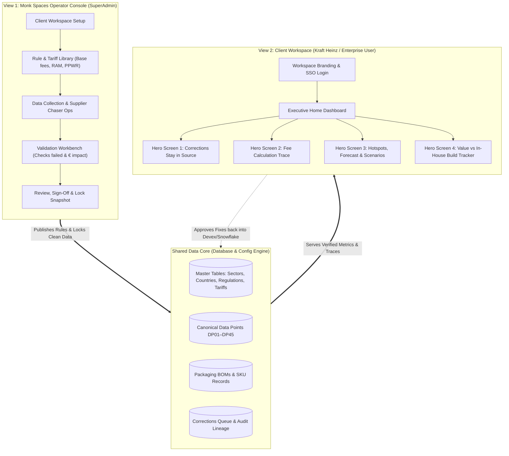
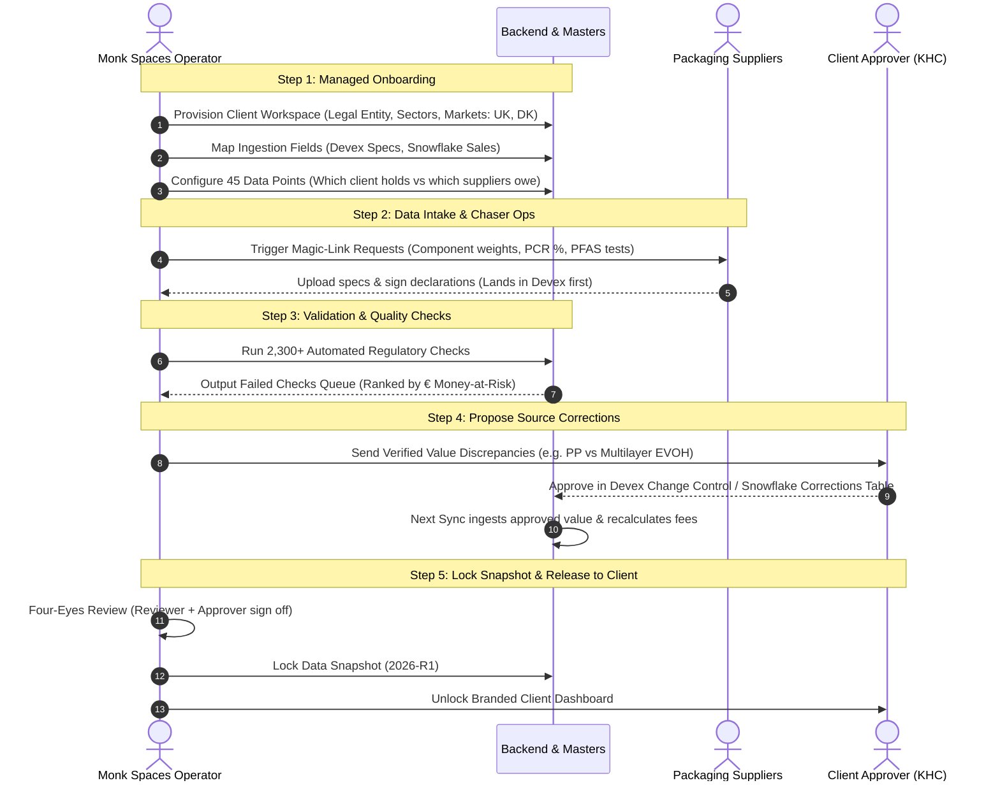

# Compliance Hub — System Architecture & End-to-End User Flow Specification

> **Document Version:** 1.0 · Managed Multi-Tenant Compliance SaaS  
> **Target Audience:** Internal Engineering Team & Monk Spaces Operations  
> **Regulatory Scope (PoV):** UK pEPR (Defra RPD), Denmark (DPA + PRO), EU PPWR (DoC, Recyclability Grades A–E), and 45 Canonical Packaging Data Points (DP01–DP45).

---

## 1. Executive Concept: "Two Views of One Data Core"

Hamara SaaS tool **ek single shared data foundation** par chalta hai, lekin iske **do distinct views** hain:



---

## 2. End-to-End Flow 1: Internal Team (Monk Spaces Operator Flow)
*Yeh flow hamari team (Monk Spaces domain consultants) run karegi har client ke liye. Client ko direct adhura data kabhi nahi dikhega.*



---

## 3. End-to-End Flow 2: Client / Company Flow (Kraft Heinz Leadership & Analysts)
*Jab Monk Spaces data verify karke snapshot lock kar dega, tab client user login karke kya dekhega.*

### Step 3.1: Sign-In & Branded Workspace Setup (Screens 1–4)
1. **SSO Sign-in:** Microsoft Azure AD / Okta corporate login (ya demo email password).
2. **Brand Customization:** Client ka logo (PNG/SVG) upload hota hai, dashboard navigation aur charts automatically client ke corporate brand mein re-theme ho jaate hain.
3. **Onboarding Summary View:** Client ko dikhta hai ki unke kaun-se markets active hain (UK pEPR + Denmark PPWR) aur kaunse upstream connectors (Trace One Devex + Snowflake) synced hain.

---

### Step 3.2: Executive Home Dashboard (Screen 5)
Leadership team (CFO, Head of Packaging, Sustainability VP) ke liye ek single consolidated screen:
- **Total Estimated EPR Fee:** e.g. `€149,000` (All markets combined in one currency).
- **Confidence Band (Uncertainty):** `±€21,000` (Data gaps ki wajah se money-at-risk clearly dikhta hai).
- **Data Completeness %:** e.g. `72%` complete.
- **Pending Approvals Pill:** `11 corrections awaiting approval`.
- **Next Filing Deadline:** e.g. `Denmark PRO: 21 days`, `UK RPD: 38 days`.
- **Market-Wise Split Cards:**
  - 🇬🇧 **UK pEPR:** `€136k (£118.4k)` with RAM RAG split (71% Green, 22% Amber, 7% Red).
  - 🇩🇰 **Denmark (DPA):** `€13k (DKK 96k)` across plastic, glass, paper, PRO admin.

---

### Step 3.3: The 4 PoV Winning Screens (Core Demonstration)

#### ① HERO SCREEN: Corrections Stay in Source (Screen 7 & 8)
> **Pitch to KHC:** *"The Hub never overwrites your master data. It reads, validates, proposes, and your team approves changes directly into Devex and Snowflake."*
- **Queue of Fixes:**
  - Was: `PP` &rarr; Verified: `PP / EVOH / PP` (+€3.1k fee effect).
  - Was: `PVC sleeve` &rarr; Verified: `PET-G` (+€2.6k fee effect).
- **Devex Change Control Integration:** Button click karne par Devex spec change request number generate hota hai.
- **Audit Trail:** Evidence attachment, sample lab weights, aur approver sign-off.

#### ② SCREEN: Calculation Trace (Screen 6)
> **Pitch to KHC:** *"Click any euro on the screen, and see the exact mathematical formula down to the raw gram and legal clause."*
- **Formula Chain:**
  $$\text{Units Placed } (2.10\text{ m}) \times \text{Tare Weight } (10.5\text{ g}) = \text{Tonnage } (22.05\text{ t})$$
  $$\times \text{Base Fee } (£455/\text{t}) \times \text{RAM Modulation } (1.2\times\text{ Red}) = \mathbf{£12,039}$$
- **Audit Traceability:** Har input ke aage source linked hota hai: `Snowflake table sales_by_market`, `Devex spec PKG-4471 v4`.
- **Legal Reason in Plain Words:** e.g. *"Pouch is Red because RAM v1.1 penalizes flexible laminates with aluminium barrier."*

#### ③ SCREEN: Cost Hotspots, Forecast & Scenario Planner (Screens 13–15)
> **Pitch to KHC:** *"Identify your most expensive 7 components and simulate material swaps with live fee recalculation net of packaging cost."*
- **Hotspots:** Top 7 components jo 53% fees drive karte hain (Soup pouch laminate, juice PET bottle, glass bottle).
- **Forecast 2026–2030:** No-change trajectory (`€237k`) vs Optimized trajectory (`€210k`) based on UK Red multiplier escalating to $1.6\times$ (2027) and $2.0\times$ (2028).
- **Scenario Simulator:**
  - Material Swap: Soup pouch `PET/alu/PP (10.5g)` &rarr; `Mono-PP + EVOH (9.8g)`.
  - Recalculation: UK RAM changes from Red to Amber (-€2.3k), Denmark fee decreases (-€1.9k).
  - Net Packaging Impact: Supplier extra cost (+€2.4k/yr) subtract karke net saving clearly show hoti hai.

#### ④ SCREEN: Value vs Internal Build Tracker (Screen 17)
> **Pitch to KHC:** *"Why building this internally in Snowflake/Databricks will cost you 18 months and huge maintenance vs buying Compliance Hub."*
- **Value Metrics:** Savings identified (`€13k/yr`), Uncertainty removed (`±€21k → ±€3.3k`), Errors fixed at source (`24`), Team hours saved per cycle (`240h → 40h`).
- **Feature Comparison Matrix:** Compliance Hub (ready in weeks, versioned tariffs maintained by Monk Spaces) vs Internal Build (constant quarterly regulatory maintenance, custom supplier portals needed).

---

### Step 3.4: Compliance Filings & Reports (Screens 9–12)
- **UK RPD File:** Official Defra submission CSV draft with 0 validation errors.
- **EU PPWR Declaration of Conformity (DoC):** Article 6 technical documentation draft for Denmark.
- **EPR Methodology Document:** Auditor-ready document explaining sampling, systems, and assumptions.

---

## 4. Complete Screen Inventory & Mapping

| Screen # | Flowchart Mapping | Screen Name | Access Role | Description & Data Source |
| :---: | :---: | :--- | :--- | :--- |
| **S01** | FC1 #1 | Sign In & SSO | All Users | Microsoft / SAML / Password login with JWT role detection |
| **S02** | FC2 #1 | Client Workspaces Directory | Operator | Multi-tenant tenant cards, active markets, SKU count, quality gaps |
| **S03** | FC2 #2 | Rule & Tariff Library | Operator | UK Defra base fees, RAM multipliers, PPWR recyclability criteria |
| **S04** | FC2 #3 | Master Data Catalog | Operator | Sectors, countries, user roles, DP01–DP45 definitions |
| **S05** | FC1 #2-4 | Managed Onboarding Wizard | Both | Legal profile, sector, country selection, live compliance matrix |
| **S06** | FC1 #5 | Executive EPR Dashboard | Client | Global cost, confidence band, hotspots preview, deadline alerts |
| **S07** | FC1 #6 | Fee Calculation Trace | Client | Exact formula chain, source proof, RAM rating legal explanation |
| **S08** | FC1 #7 | Data Health & Quality Workbench | Both | Gaps ranked by € at risk, Devex vs supplier mismatches |
| **S09** | FC1 #7 (Hero) | Corrections to Source | Both | Discrepancy queue, Devex change requests, write-back table |
| **S10** | FC1 #8 | Confirm & Lock Snapshot | Both | Uncertainty reduction (±€), reviewer approval, frozen snapshot |
| **S11** | FC1 #13 | Cost Hotspots Analysis | Client | Top 7 cost drivers, cumulative cost %, Red rating indicators |
| **S12** | FC1 #14 | Forecast 2026–2030 | Client | Known regulatory escalations (UK Red multiplier 1.2x -> 2.0x) |
| **S13** | FC1 #15 | Scenario Planner | Client | Material swap what-if simulator net of packaging cost |
| **S14** | FC1 #16 | Ranked Recommendations | Client | Prioritized engineering changes with annual € savings |
| **S15** | FC1 #17 | Value vs Internal Build | Client | Hard ROI tracker, hours saved, buy vs build matrix |
| **S16** | FC1 #9-12 | Filings & Declarations (RPD & DoC) | Client | Official exportable files (RPD CSV, EU DoC PDF, Methodology) |

---

## 5. Database Architecture & Seed Hygiene

1. **`backend/seeds/` (Isolated Seed Directory):**
   - `data_points_seed.json`: 45 canonical data points (DP01–DP45) with source systems and regulation mapping.
   - `tariffs_seed.json`: UK Defra 2025/26 base tariffs + Denmark DPA rates.
   - Core runtime (`backend/app/`) remains untouched by one-off scratch scripts.
2. **Dynamic Ingestion & Store (`backend/app/services/store.py`):**
   - In-memory thread-safe store with JSON snapshot persistence.
   - Tenant isolation enforced on every request via `X-Tenant-ID` or JWT claims.
   - Ready for PostgreSQL migration via standard SQLAlchemy/SQLModel models.

---

## 6. Execution Plan & Next Steps

```
[Done] Step 1: JWT Authentication & Role-Based Layout
[Done] Step 2: Left Persistent Sidebar (Monochrome Enterprise Swiss Design)
[Done] Step 3: Backend Master Tables & Regulatory Config Engine (Sectors, Countries, Tariffs)
[Done] Step 4: SuperAdmin Monk Spaces Console (Rule & Tariff Library Tab)
[Done] Step 5: Live Cloud Deployment & Auto-Proxy (Vercel + Render)

[Next] Step 6: Polish Executive Home Dashboard with KHC KPI Cards & Market Breakdowns
[Next] Step 7: Build Screen 1 (Hero): "Corrections Stay in Source" (Queue & Change Requests)
[Next] Step 8: Build Screen 2: "Calculation Trace" (Formula breakdown modal/drill-down)
[Next] Step 9: Build Screen 3: "Hotspots & Scenario Planner" (Material swap simulation)
[Next] Step 10: Build Screen 4: "Value Tracker: Buy vs Build" (ROI & audit savings)
```
