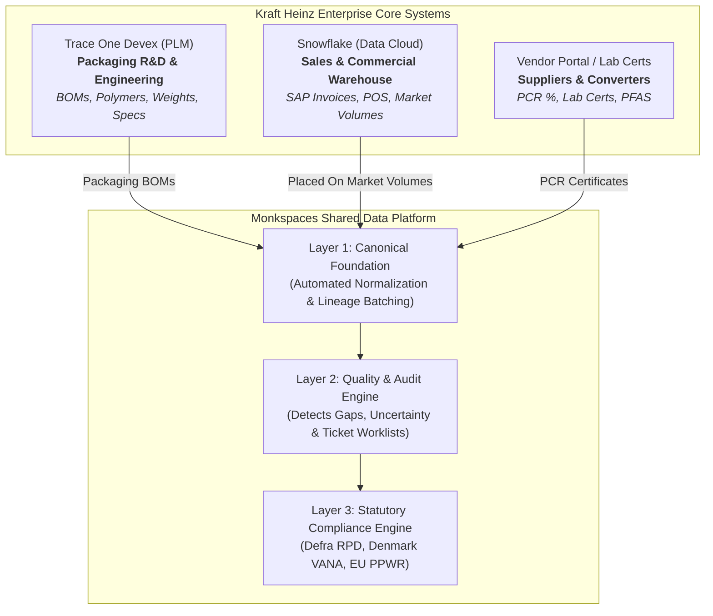
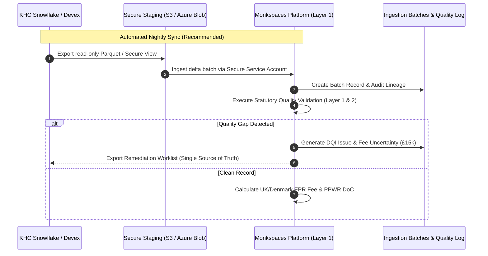

# Enterprise Data Integration Blueprint
## Connecting Snowflake & Trace One Devex PLM to Monkspaces Compliance Hub

> **Target Audience:** Client Technical Leads, Solutions Architects, Compliance Stewards & Ingestion Engineers  
> **Prepared For:** The Kraft Heinz Company (KHC) & Enterprise Packaging Clients  
> **Classification:** Technical Reference Architecture & Implementation Guide  

---

## Executive Summary: What Are These Systems?

To an enterprise CPG giant like Kraft Heinz, compliance data never lives in a single database. It is split between **Engineering (Packaging Specs)** and **Commercial (Sales Volume)**:

### 1. What is Trace One Devex (PLM)?
* **Type:** Product Lifecycle Management (PLM) System.
* **Role in KHC:** This is the tool used by Kraft Heinz packaging engineers and food formulation scientists to design products before they ever hit the shelf.
* **What Data Lives Inside:** 
  - Exact Bill of Materials (BOM) for every jar, bottle, cap, label, and pouch.
  - Component empty weights (tare weight in grams).
  - Material substrates (Clear PET, Tinplate, HDPE, PP, Cardboard).
  - Food contact regulatory declarations and child-safety specifications.
* **Analogy:** Devex is the **"Blueprints & Recipe Book"** of the packaging.

### 2. What is Snowflake (Data Cloud)?
* **Type:** Enterprise Cloud Data Warehouse & Analytics Platform.
* **Role in KHC:** Snowflake pulls nightly snapshots from KHC’s core SAP ERP (S/4HANA), sales pipelines, and logistics systems.
* **What Data Lives Inside:**
  - Placed-on-market packaging volumes (how many units of Heinz Beanz or Mac & Cheese were shipped).
  - Destination country (UK, Denmark, France, Germany).
  - Sales channels (Retail / Supermarkets vs Food Service / Restaurants).
  - Invoices, GTINs/Barcodes, and fiscal reporting periods (2025-H2, 2026-H1).
* **Analogy:** Snowflake is the **"Odometer & Register"** of how much packaging actually entered each country.

---

## The 40 Data Points: Who Holds What?

Under UK Defra RPD and EU PPWR regulations, 40 distinct data points are legally required to calculate fees and generate technical files. Here is the exact distribution:

| Source System | DP Count | Key Data Points Captured | Why It Matters for Compliance |
|---|---|---|---|
| **Snowflake (Sales & ERP)** | **10 Data Points** | • `DP01` SKU Identifier • `DP02` GTIN / Barcode • `DP03` Component Count • `DP05` Units per pack • `DP22` Units sold by country • `DP23` Sales channel (Retail vs B2B) • `DP24` UK Delivery nation • `DP25` Exported volumes • `DP27` Import country • `DP43` Vendor reference code | Converts packaging grams into **total statutory metric tonnes** placed on the market. |
| **Trace One Devex (PLM)** | **10 Data Points** | • `DP04` Packaging Level (Primary/Secondary) • `DP06` Component Material (PET, ALU, PP) • `DP09` Empty Tare Weight (grams) • `DP15` Reusable vs Single-Use • `DP16` Food Contact certification • `DP20` Packaging Minimisation proof • `DP21` Empty space / headspace ratio • `DP39` Material labeling standard • `DP40` QR code / DPP data carrier • `DP44` Tare weight source | Determines the **tariff rate (£/tonne)** and eco-modulation penalties or bonuses. |
| **Suppliers & Vendors** | **11 Data Points** | • `DP07` Specific Polymer Grade • `DP08` Multi-material layers • `DP10` Colour & Opacity (Carbon Black vs Clear) • `DP11` Inks, adhesives & labels • `DP12` Recyclability test lab certificate • `DP13` Post-Consumer Recycled (PCR) % • `DP14` Recycled content traceability certification • `DP17` PFAS / Forever chemicals declaration • `DP18` Heavy metals screening (<100ppm) • `DP19` SVHC REACH substances • `DP42` Technical file document attachments | Unlocks **eco-modulation fee discounts** (e.g. 30%+ PCR discount) and proves safety. |
| **KHC Compliance Team** | **9 Data Points** | • `DP26` Deposit Return Scheme (DRS) status • `DP28` Producer role (Brand Owner / Importer) • `DP29` Statutory EPR registration number • `DP30` Compliance scheme membership (Valpak, etc.) • `DP31` Authorized Representative • `DP32` Organization annual turnover & size tier • `DP33` Reporting period lock date • `DP41` DoC regulatory reference • `DP45` Officer sign-off and legal declaration | Statutory corporate identity and **legal executive certification**. |

---

## How to Connect: Recommended Industry Architecture

Enterprise clients will **never** allow a third-party tool direct administrative write access to their core ERP. Below are the two sanctioned industry standards:

### Approach 1: Snowflake Direct Secure Share (Zero ETL — Best Standard)
* **How It Works:** Snowflake has a built-in feature called **Snowflake Secure Data Sharing**. KHC’s Snowflake admin shares a read-only secure view directly with our Snowflake account or allows a dedicated read-only service account.
* **Pros:** 
  - Zero data copying or file exports needed.
  - Real-time or micro-batch sync.
  - Complete control: KHC can revoke access with 1 click.
* **Credentials Required:**
  - Snowflake Account Identifier (e.g., `khc-eu.snowflakecomputing.com`)
  - Warehouse & Database/Schema name (e.g., `ANALYTICS_PROD.COMPLIANCE_VIEWS`)
  - Role: Read-Only Service Account (e.g., `MONKSPACES_READONLY_ROLE`)
  - Key-pair authentication (JWT / RSA Public Key).

### Approach 2: Trace One Devex PLM REST API / Secure Data Drop
* **How It Works:** 
  - Trace One provides a REST Integration API.
  - Monkspaces queries packaging specifications by SKU/spec number.
  - Alternatively, KHC’s Devex system schedules a nightly automated export of active finished goods packaging specs into an encrypted cloud bucket (AWS S3 or Azure Blob).
* **Credentials Required:**
  - OAuth2 Client ID & Client Secret.
  - Tenant API Gateway Base URL (e.g., `https://api.traceone.com/devex/v2/khc/specs`).
  - IP Whitelisting: Monkspaces static outbound egress IPs.

---

## What We Need to Share with KHC (Client Deliverables)

When meeting with the KHC IT and Data Governance team, share the following official bundle:

### 1. Inbound Data Schema Contract (JSON / CSV Specification)
We provide KHC with our canonical field specifications:
* SKU Header: `sku`, `brand`, `product_name`, `category`, `gtin`
* Packaging Component: `component_id`, `name`, `level (Primary/Secondary/Tertiary)`, `material`, `weight_grams`, `recycled_content_pct`, `is_recyclable`
* Sales Volume: `reporting_year`, `jurisdiction (UK/DK/FR)`, `units_sold`, `sales_channel`

### 2. Security & Compliance Guarantee
* **Principle of Least Privilege:** We only request `SELECT` (Read-Only) permissions.
* **Zero Write-Back to Source:** Monkspaces will **never** alter master records in Devex or Snowflake directly. Instead, any corrections are returned as structured **Remediation Worklists** for KHC packaging engineers to approve in their own systems.
* **Encryption:** AES-256 at rest, TLS 1.3 in transit.
* **Audit Immutability:** Every incoming sync is assigned a traceable `batch_id` and timestamp.

---

## First-Time Connection Checklist for Your Team

Follow this 5-step checklist for the first sync meeting:

1. [ ] **Kickoff Meeting:** Align on Inbound Schema with KHC Data Steward and Packaging Engineer.
2. [ ] **Sandbox Access:** Request read-only access to a Sandbox / Pre-Prod Snowflake view with 10 sample SKUs.
3. [ ] **Verify Lineage:** Ingest sample batch in Monkspaces (`BATCH-INIT-001`) and verify that 40 Data Points map correctly in `/data-overview`.
4. [ ] **Run Quality Rules:** Check that missing tare weight or polymer triggers a clear gap (`DQI-XXXX`) without breaking calculations.
5. [ ] **Automate Cron:** Switch from manual CSV ingestion to scheduled automated nightly sync.
