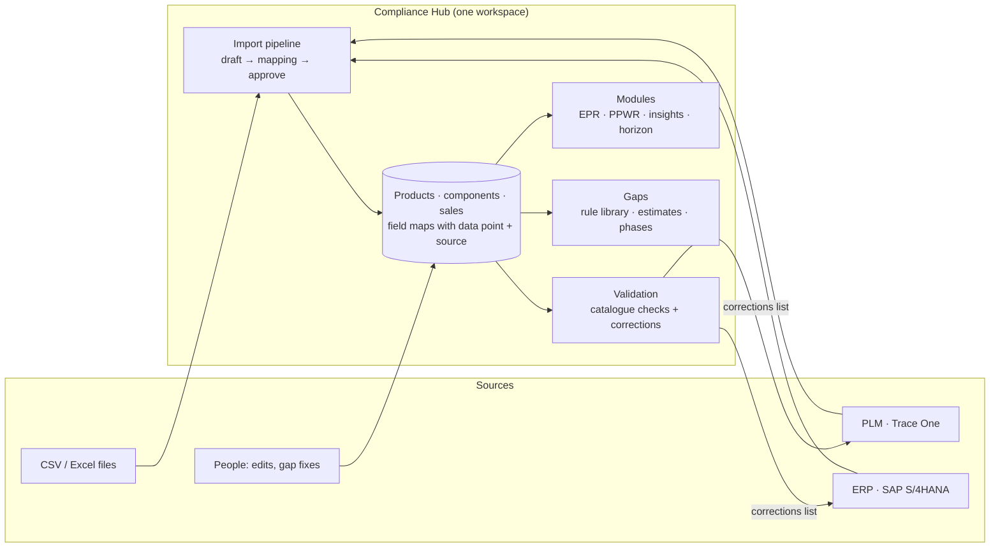
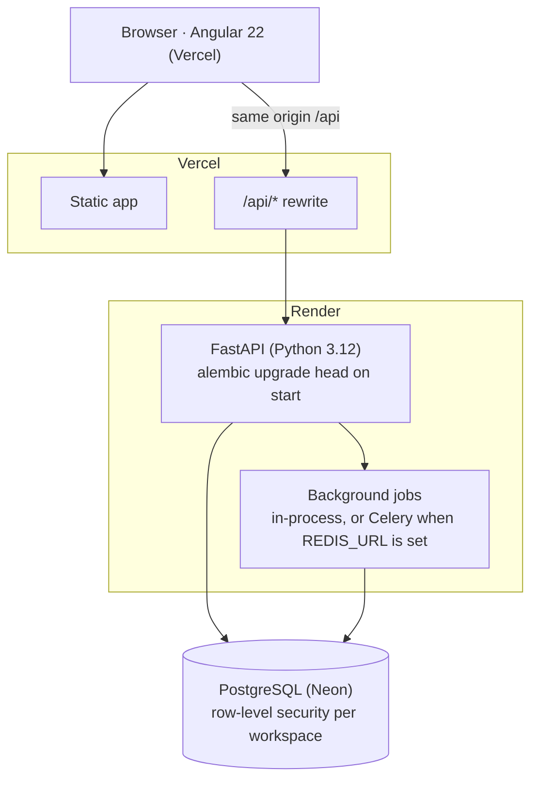
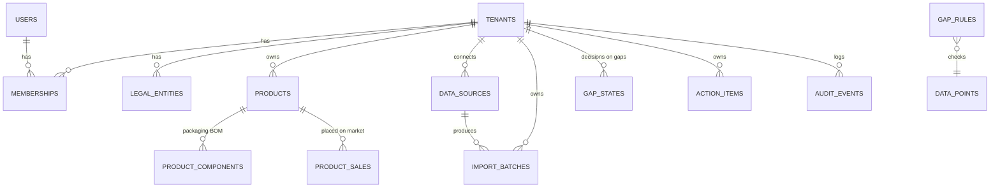

# Compliance Hub — System design (HLD)

How the platform is built, how client data flows through it, how it is stored, checked and reused, and what happens when data is synced again. Read this before changing anything that touches client data.

**Keep it current.** This document describes the code on `main`. Any change to storage, the import or sync pipeline, validation, gaps, compliance calculations, permissions or deployment updates this file in the same commit (rule 6 in [AGENTS.md](../AGENTS.md)). The "Last reviewed" line and the change log at the end say when.

Last reviewed: 12 Nov 2026 (per-SKU rules; data explorer for platform admins).

---

## 1. What the platform does

Compliance Hub is a multi-tenant SaaS for packaging compliance. Each client (a **workspace**) brings its product and packaging data in once, from files and from its systems (ERP, PLM). The platform checks that data, finds what is missing or wrong, helps fill and correct it, and reuses the same records for every regulation the client is subject to: national EPR fees, EU PPWR declarations, horizon scanning, and later DPP and LCA.



The demo journey this supports: set up a workspace → collect data (systems and files) → find gaps (estimable or not) → validate and correct → compliance results (EPR UK, EPR Denmark, SB 54, PPWR Denmark declarations) → hotspots and recommendations → scenarios → horizon scanning.

---

## 2. Architecture



| Layer | Technology | Where |
| --- | --- | --- |
| Frontend | Angular 22, standalone components, signals; typed API client generated from OpenAPI | `frontend/src/app` |
| API | FastAPI, Pydantic v2, SQLAlchemy 2 (async, psycopg) | `backend/app` |
| Database | PostgreSQL with row-level security (RLS); Alembic migrations | `backend/migrations` |
| Jobs | One job interface; runs in the API process, or on Celery workers when `REDIS_URL` is set | `backend/app/core/jobs.py` |
| Hosting | Vercel (frontend, proxies `/api` to Render) and Render (API); `main` deploys automatically | `vercel.json`, `render.yaml` |
| CI | GitHub Actions: lint, type check, backend tests on a real Postgres, frontend build and tests, OpenAPI client drift, secret scan | `.github/workflows/ci.yml` |

### Backend modules

| Package | Responsibility |
| --- | --- |
| `app/core` | Settings, database sessions, tenancy (RLS), sign-in tokens and permissions, audit log, jobs, error format |
| `app/platform` | Workspaces (tenants), users, memberships, sign-in, bootstrap demo accounts |
| `app/catalog` | Data point dictionary, field catalogue, products/components/sales, value lineage (`fields.py`, `service.py`) |
| `app/ingestion` | Import batches, column mapping, simulated ERP/PLM syncs, data sources, the import job |
| `app/quality` | Gap rules, gap engine, estimates, validation |
| `app/modules` | Compliance: EPR fees, PPWR declarations, hotspots and recommendations, scenarios, action items, horizon |
| `app/api/v1` | HTTP endpoints, one file per screen or domain |

Rule of thumb: endpoints are thin; logic lives in the package it belongs to, and shared helpers exist once (`catalog/fields.py`, `catalog/service.py`, `core/errors.py`).

---

## 3. Tenancy, sign-in and permissions

**One database, isolated by Postgres row-level security.** Every client table has a `tenant_id` and RLS policies (`enable_tenant_rls()` in each migration). Each request runs in a transaction that sets `app.tenant_id` from the signed token and switches to a role that cannot bypass RLS (`SET LOCAL ROLE compliance_rls`). Queries never filter by tenant by hand; the database does it, so a coding mistake cannot leak another client's rows.

- **The workspace comes from the token only**, never from a header, URL or browser storage. Switching workspace issues a new token (`POST /auth/switch-tenant`).
- **Sign-in:** 15-minute access token (kept in `sessionStorage`), 8-hour refresh token in an httpOnly cookie (stored server-side only as a SHA-256 hash, rotated on every refresh). Five wrong passwords lock an account for 15 minutes; 30 minutes without input signs the user out. Passwords are Argon2 hashes.
- **Every request re-checks the user in the database**, so disabling a user, suspending a workspace or removing a membership takes effect on the next request; those actions also revoke refresh tokens.
- **Permissions, not roles, guard every endpoint** (`require_permission(...)`, `app/core/permissions.py`):

| Role | Where | Can |
| --- | --- | --- |
| Platform admin | Monk Spaces | Every workspace, users, data points, gap rules; inside a workspace, what its org admin can |
| Consultant | Assigned client workspaces only | The client's compliance work and settings; not its team |
| Org admin | One client | Everything in the workspace, including its team and settings |
| Analyst | One client | Data, imports, gaps, actions |
| Viewer | One client | Read only |

- **Modules are plug-ins.** A workspace's modules (EPR, PPWR, DPP, LCA) become `module.<id>` permissions for its members. Module screens and endpoints require them, so switching a module off removes it for that client at once. A workspace with no modules set has all of them.

---

## 4. How data is stored

### 4.1 Data model



| Table | Scope | Holds |
| --- | --- | --- |
| `tenants` | Platform | Workspace: name, slug, status, branding (logo, colour), countries, modules, horizon lead time |
| `users`, `memberships` | Platform | People, their role per workspace, status, last sign-in |
| `legal_entities` | Tenant (RLS) | Companies inside a client |
| `data_points` | Platform | The regulatory dictionary (DP01…), its source system, outputs and the date it applies from |
| `products` | Tenant (RLS) | One row per SKU: `fields` and `passport` field maps |
| `product_components` | Tenant (RLS) | Packaging components of a product: `fields` map, stable `code` |
| `product_sales` | Tenant (RLS) | Units placed and exported per period and channel |
| `import_batches` | Tenant (RLS) | Every file or sync: columns, rows, mapping, status, result — the import history |
| `data_sources` | Tenant (RLS) | Connected ERP/PLM, saved mapping, auto-approve, last sync |
| `gap_rules` | Platform | The rule library (field, check, severity, modules, countries, estimate method) |
| `gap_states` | Tenant (RLS) | What people decided about a gap (requested, resolved) |
| `action_items` | Tenant (RLS) | Recommendations turned into tasks |
| `audit_events` | Tenant (RLS) | Who changed what, before and after |
| `jobs` | Tenant (RLS) | Background job status and result |

### 4.2 Field maps and lineage

Product, passport, component and sales values are stored as **field maps** (JSONB), keyed by the field catalogue:

```json
{
  "weight_g":  { "dp": "DP09", "value": "26",      "source": "plm" },
  "material":  { "dp": "DP06", "value": "Plastic", "source": "correction" },
  "gtin":      { "dp": "DP02", "value": "",        "source": null }
}
```

- `dp` ties every value to the regulatory data point it answers, so gaps, coverage and every compliance module read the same record.
- `value` is always text, exactly as received or entered; numbers are parsed where they are used.
- `source` is the value's **lineage**: `csv`, `erp`, `plm`, `manual` (a person), `estimate` (filled by an estimation rule) or `correction` (a validation suggestion applied). An empty `""` means "asked for but missing" and drives gaps.
- **Nothing is computed and stored.** Totals, completeness, gaps, fees and readiness are calculated on read from these values, so they can never disagree with the data.

The field catalogue (`app/catalog/reference/fields.json`) defines every field: label, data point, level (Product, Passport, Component, Sales…), type (Number, Code, Yes/No, Date, URL, Text) and allowed values or range. It is generated from the team's data set (`reference-docs-teams/datapoints-epr-ppwr-main`) by `backend/scripts/make_reference_data.js`. The same folder is published unchanged at `/datapoints/` (copied into `frontend/public` by `frontend/scripts/copy-datapoints.js` on build and start) and shown to platform admins as **Data explorer** (flowchart, table, checklist and SKU data view of the data points by country and regulation). It is static reference content: it reads no client data and is public to anyone with the URL.

---

## 5. Getting data in

### 5.1 One pipeline for files and systems

```mermaid
sequenceDiagram
  participant U as User / Data source
  participant API as API
  participant DB as Database
  participant J as Import job
  U->>API: POST /imports (CSV rows) or /imports/sync (ERP/PLM) or /data-sources/{id}/sync
  API->>DB: import_batches: draft, suggested mapping
  API-->>U: draft (columns, mapping, targets)
  U->>API: PUT /imports/{id}/mapping
  API-->>U: preview: valid / rejected rows, new / updated products, warnings
  U->>API: POST /imports/{id}/approve
  API->>DB: batch approved, job queued (after commit)
  J->>DB: upsert products, components, sales; batch imported; source last sync; audit
  U->>API: GET /jobs/{id} (progress)
```

1. **Draft.** The rows arrive (a CSV parsed in the browser, or a system sync) and are stored as an import batch.
2. **Mapping.** Each column is mapped to a catalogue field. Suggestions come from field keys, labels and common names ("Article" → SKU, "EAN" → GTIN, "Weight (g)" → weight). A data source reuses the mapping saved at its last approved import; a CSV with the same columns as an earlier file reuses that file's mapping.
3. **Preview.** Rows missing a **SKU, product name or component** are rejected (with row and column). Everything else is imported; values the catalogue does not accept ("26 g", "plastic") come in as they are and are listed as **warnings** to correct in Validation.
4. **Approve.** A background job writes the rows. One row = one packaging component; product values repeat on each of its rows.
5. **Auto-approve.** A data source with auto-approve on, a saved mapping and no rejected rows imports straight away after a sync.

The **simulated ERP and PLM** (`app/ingestion/sync.py`) read the sample client's records and send only the fields whose data point comes from that system (the dictionary's `source`): ERP sends the product master and sales, PLM the packaging specifications. Fields neither system holds (supplier declarations, manual data) stay empty and become gaps. A few values are exported with typical formatting mistakes (`EXPORT_QUIRKS`) so validation has something real to find. Real connectors replace this module later.

### 5.2 What happens on a re-sync (or a re-import)

Matching:

- **Products** match by **SKU**. A new SKU creates a product.
- **Components** match by **component ID** (the system's ID, or `SKU-01`, `SKU-02`… for files), then by **component name**; otherwise a component is added.
- **Sales lines** match by their ID; otherwise one is added.

Values (`catalog/service.merge`):

| Incoming value | Stored value | Result |
| --- | --- | --- |
| Non-empty | Anything (including a manual edit, an estimate or a correction) | **Replaced** by the incoming value; `source` becomes the file or system |
| Empty | Present | **Kept** — an empty cell never wipes data |
| Empty | Absent | Stored as empty (asked for, missing) |

Consequences to know:

- **The source system wins.** A value corrected in the platform is overwritten by the next sync if the system still holds the old value. That is why Validation exports a corrections list per source system: fix it there too, and the platform stays the single source of truth. (Write-back to the systems comes with real connectors.)
- **Estimates are replaced by real data** as soon as a system sends a value for that field.
- **Nothing is deleted by a sync.** Components or products missing from a sync stay; remove them on the product page.
- **Gaps, fees and readiness update immediately**, because they are computed on read.
- **Decisions on gaps persist.** A gap's identity is `rule:component` (or `rule:SKU`), so "requested from supplier" or "accepted" survives re-syncs. A gap disappears by itself once a sync brings a valid value.
- **History is kept**: every batch stays in `import_batches` (shown as sync history), every job and change in `jobs` and `audit_events`.

### 5.3 People editing data

On the product page people edit product and passport fields, edit, add or remove components (`PATCH /products/{sku}`, `/components/{code}`). Every value is validated first (section 6), stored with `source: manual`, and every change is written to the audit log field by field; the page shows it as **History**. Fixing a gap with a value goes through the same path.

---

## 6. Validation

`app/quality/validation.py` checks a value against the field catalogue and, where it can, works out the correction:

| Field type | Checked | Suggested correction |
| --- | --- | --- |
| Number | Is a number; within range (e.g. 0–100 %); not negative | "26 g" → 26, "0.026 kg" → 26 (grams), "2,5" → 2.5, "30%" → 30 |
| Code (allowed values) | One of the listed values | Case ("plastic" → "Plastic"), close spelling ("Plastik" → "Plastic") |
| Yes/No | Yes or No | "yes", "Y", "true", "ja" → "Yes" |
| Date | YYYY-MM-DD and a real date | "10/08/2026", "10 Aug 2026" → 2026-08-10 |
| URL | Starts with http(s):// | "id.example.com/…" → "https://id.example.com/…" |
| GTIN | 8/12/13/14 digits, GS1 check digit | Spaces and dashes removed |
| Any | No surrounding spaces | Trimmed |

Empty values are not validation problems (they are gaps); "n/a" means not applicable.

Where it applies:

- **Edits and gap fixes** are refused with the message and "Did you mean …?"; the screen offers a one-click "Use …".
- **Imports** accept such values and list them as warnings (a row is never lost over formatting).
- **The Validation screen** (`GET /validation`) lists every invalid stored value with its correction and source system. Corrections are applied one by one or all at once (`POST /validation/apply`, stored with `source: correction`, audited), and **Export for source systems** downloads the list per ERP/PLM/file for the teams who own the data.

---

## 7. Gaps

A **gap** is a value a rule says is missing or not good enough.

- **Rule library** (`gap_rules`, platform admins): each rule names a field and data point, a check (`missing`, `in` a list of values, certificate missing, PFAS declaration missing), a severity (blocker, warning), the modules it serves and optionally countries.
- **Scope:** a workspace sees a rule only if it has one of the rule's modules and (when set) one of its countries.
- **Engine** (`quality/engine.py`): runs the applicable rules over every product and component on every read. Only people's decisions are stored (`gap_states`).
- **Estimable or needs data:** a rule may carry an estimate method — `similar_average` (average of the same field on components of the same material and packaging level, then material, using recorded values only) or `fixed` (e.g. 0 % recycled content). "Fill estimates" writes those values with `source: estimate` and marks weights as `Estimate`. Certificates, declarations and identifiers always need real data.
- **Phase (horizon):** each gap's data point has the date it applies from (dictionary). With the workspace's lead time (default 3 months), a gap is **due now** (in force), **collecting** (inside the lead time) or **upcoming**; the Gaps screen shows due gaps first.
- **Fixing:** enter a value (validated, `source: manual`), ask the supplier (status requested), accept, or use the estimate.

---

## 8. Compliance results

All results are calculated on read from the stored values (`app/modules`).

- **EPR fees** (`epr.py`): for each sales line in the year sold in the regime's country (the sales line's `market`; a line without one counts for every regime), units on the market = placed − exported; each component adds units × weight per unit ÷ units per pack to its material's tonnage; tonnage × the regime's rate gives the fee, for the channels the regime charges (UK: household packaging). Components without a weight or material are reported as data issues, never guessed. Rates live in `reference/regimes.json`: UK uses the published 2025/26 base fees; EPR Denmark and SB 54 use labelled placeholders until real rates are supplied. From a regime's `modulation.from_year` the rate is multiplied by the component's rating factor (UK 2026/27: Red 1.2, Amber 1.0, Green 0.9, indicative; Denmark: Green −20%, Red +35%, placeholder); the screen says so.
- **Per-SKU rules** (`assessment.py`, rules in `reference/assessment.json`, combined per SKU by `skus.py`), shown in the SKU library and on each product:
  - *UK RAM rating* per component: a rating stated in the recyclability result wins; otherwise Red for carbon-black plastic, PVC or PS, a main material under 80% of the component (from the material split), a poor result or no assessment (unassessed packaging is Red under RAM); Amber for a limited result or a main material under 95%; Green for a good result. The SKU shows its worst rating.
  - *PPWR recyclability grade*: per component, the main material's share capped by the result (good 100, limited 75, poor 40), black plastic (60) and PVC/PS (40); per packaging unit, the weight-weighted share of the primary components. A from 95%, B 80%, C 70%, D 50%, else E; D and E fail from 2030. A grade stated in the result wins. Thresholds below C are indicative until the delegated acts.
  - *Recycled content*: per packaging unit (the components of one packaging level), the plastic part's weight-weighted recycled share against the 2030 target: 30% contact-sensitive mainly PET, 10% other contact-sensitive, 35% the rest; plastic under 5% of the unit's weight is exempt.
  - *Markets*: the countries of the SKU's sales lines (lines without a market add every workspace country). *Fee per regime*: from the same engine, for each EPR regime the workspace covers, in its own currency.
  - *Status*: at risk (sold in the EU with PPWR on, and a grade that fails 2030 or recycled content below target), issue (open gaps or a component without material), otherwise OK; each with its reasons.
- **PPWR declaration** (`ppwr_doc.py`): built per product in Danish or English from its fields; checks substances (PFAS in food contact, heavy metals), recyclability (the PPWR grade above), recycled content (the per-unit targets above, with certificates), minimisation and labelling, showing the evidence for each; "ready" or "draft" with what is missing. Printed to PDF from the browser.
- **Hotspots and recommendations** (`insights.py`): the components, products and materials carrying the fee, each with its arithmetic; rule-based recommendations (lightweight against similar components, measure estimated weights, recyclability redesign, recycled content) with their impact. Recommendations become **action items**.
- **Scenarios:** the same EPR calculation with changed weights or materials, not saved.
- **Horizon:** milestones from the dictionary dates (PPWR 12 Aug 2026, labelling 12 Aug 2028, recyclability and recycled content 2030, UK DRS Oct 2027, SB 54 2032), when data collection starts, and how ready the workspace's data is.

---

## 9. Per-client configuration (SaaS)

| Configurable per workspace | Where |
| --- | --- |
| Name, logo, brand colour, legal entities, countries | Client workspaces |
| Modules (plug-ins) | Client workspaces |
| Members and roles; consultants | Users (platform), Team (org admin) |
| Connected systems, saved mappings, auto-approve | Data sources |
| Horizon lead time | Horizon |

Platform-wide today: the gap rule library, EPR rates, the field catalogue and wording (see [IMPROVEMENTS.md](IMPROVEMENTS.md)).

---

## 10. Audit, reliability and operations

- **Audit log:** sign-ins, workspace and user changes, imports, edits, corrections, gap decisions and settings are written to `audit_events` with who, what, before and after, in the same transaction as the change.
- **Errors:** every error is an RFC 7807 problem response; field errors carry `loc` so the screen shows them next to the field. Every log line carries a request ID.
- **Background jobs:** started only after the transaction commits; status and result in `jobs`, polled by the screen.
- **Migrations:** Alembic, applied automatically on deploy (`alembic upgrade head`). A failing migration fails the deploy and the previous version keeps serving. Current head: `0011_ensure_rls_role`. Roles are not part of a database dump: a restored or new database needs `alembic upgrade head` (0002 and 0011 create `compliance_rls`) before the API can serve; `/api/v1/health/ready` returns 503 "migrations not applied" until then. The service's start command must include `alembic upgrade head`.
- **Tests:** CI creates a fresh Postgres database, runs every migration and the API tests, including tenant-isolation tests on each client endpoint. The frontend has component tests; the typed API client must match the backend (CI fails on drift).
- **Demo data:** `seeds/bootstrap_users.json` (Argon2 hashes only) creates the demo accounts on first sign-in; the simulated syncs fill a workspace with the sample client's products.

---

## 11. How the platform is developed

- **Screen by screen, on a shared foundation** ([SCREEN_BY_SCREEN_BUILD_PLAN.md](SCREEN_BY_SCREEN_BUILD_PLAN.md)): each screen is a vertical slice — migration, API with permissions and audit, UI, tests.
- **Contract first:** endpoints and shapes are defined in FastAPI; `npm run api:generate` produces the typed client the screens use (`frontend/src/app/core/api`), so frontend and backend cannot drift.
- **Branches:** work happens on `screen/NN-name` branches; CI runs on every push; `main` deploys.
- **DRY:** shared helpers exist once — field values (`catalog/fields.py`), writing values (`catalog.assign`), errors (`core/errors.py`), shared UI pieces (`shared/ui`, global platform styles).
- **Postponed work** is tracked in [IMPROVEMENTS.md](IMPROVEMENTS.md) with where it lives.

---

## 12. Known limits

- Systems are **simulated**; real SAP/Trace One connectors, scheduled syncs and write-back need client IT access.
- A sync **overwrites** platform corrections with the system's value (section 5.2); fix at the source.
- Sales lines without a **market** count for every regime of the workspace; the sample data has none yet.
- EPR Denmark and SB 54 **rates are placeholders**; UK modulation factors are indicative until the published modulated fees are entered.
- The RAM rating and PPWR grade are simplified rule sets, not a full RAM or design-for-recycling assessment; a stated rating or grade always wins.
- **Demo accounts are shown on the sign-in page** (platform admin and Kraft Heinz org admin, with passwords) while `DEMO_SIGN_IN` is not `false`: anyone with the link can sign in. Switch it off and change those passwords before real client data.
- A gap marked resolved by a person stays resolved even if a later value fails the rule again.
- Gaps and results are computed on every read: fine for hundreds of products; storing computed gaps is planned for larger clients.
- Invitation and password emails wait for the email service.

---

## Change log

| Date | Change |
| --- | --- |
| 12 Nov 2026 | Per-SKU rules: RAM rating, PPWR grade, recycled content per packaging unit, markets from sales lines, fee per regime with rating modulation, status; the PPWR declaration uses the same rules. |
| 12 Nov 2026 | Migration 0011 recreates the `compliance_rls` role on databases that lack it; readiness checks the role. |
| 12 Nov 2026 | Data explorer: the team's data point explorer served as-is at `/datapoints/`, shown to platform admins. |
| 12 Nov 2026 | Demo accounts on the sign-in page behind `DEMO_SIGN_IN` (known limits). |
| 12 Nov 2026 | First version: architecture, tenancy, storage and lineage, import and re-sync rules, validation, gaps, compliance, configuration, operations. |
