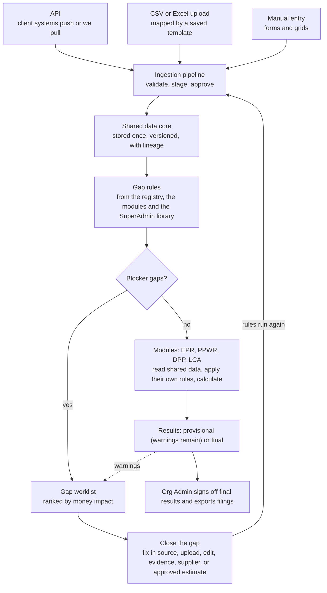
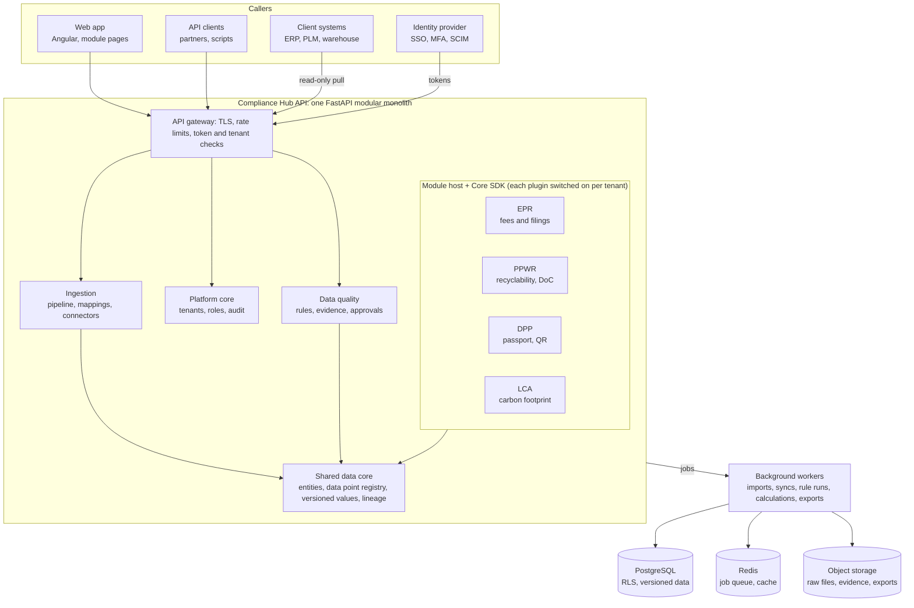
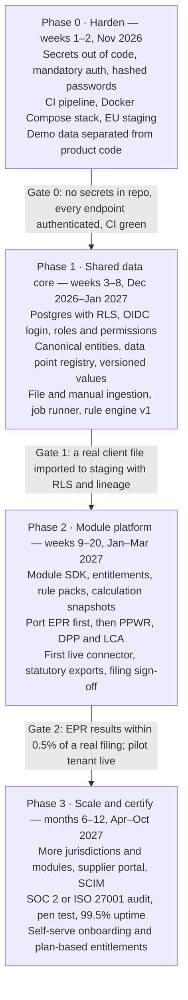

# Compliance Hub — Target Architecture & Improvement Plan

Nov 11, 2026 · Owner: Raman

> Source of truth while editing: the Claude doc "Compliance Hub — Target Architecture & Improvement Plan". This Markdown copy is kept in the repo for reference; update it when the plan changes.


## Executive summary

Compliance Hub has a strong demo and a weak foundation, so the next 12 weeks should rebuild the core before adding features. The UI covers the full story, from onboarding through data quality to fee simulation. Underneath, the system has no real database, no enforced tenant isolation, and module logic hard-wired into one 1,700-line in-memory store.

The target is a **shared-data, plugin-based, multi-tenant SaaS**. Product and packaging data is captured once, through API, file upload or manual entry. Compliance modules (EPR, PPWR, DPP, LCA and future ones) plug into that shared core. Each module brings its own rules, calculations, extra data points and outputs, and the core never needs to change for a new regulation.

Five decisions shape everything below:

1. **Modular monolith first.** One FastAPI codebase with strict internal module boundaries. Split into services only when a module has a proven scaling or team-ownership need.
2. **PostgreSQL is the system of record.** One shared schema with `tenant_id` on every row, enforced by Postgres Row-Level Security. JSON files and seed-in-code go away.
3. **A data point registry drives the data model.** Core entities (company, product, packaging component, material, sales) are typed tables. Module-specific fields are registered data points, validated by schema and stored in typed extension tables.
4. **Modules are plugins with a published contract.** Each declares its data points, validation rules, calculators, outputs and UI pages, and is switched on per tenant through entitlements.
5. **Identity is bought, not built.** An OIDC provider handles login, SSO and MFA. The platform owns only organisations, memberships, roles and permissions.

The plan runs in four phases: harden the foundation, build the shared data core and ingestion, port the four modules onto the plugin contract, then scale and certify. Phase 0 (security fixes) should start this week.

## How the product works end to end

The product is one loop: bring the client's data in, find the gaps, close them, and let each module turn complete data into results. Modules never wait for perfect data; they show provisional results with an uncertainty band until the gaps that matter to them are closed.

1. **Data comes in.** The client sends product, packaging and sales data through the API or a CSV/Excel upload, or types small items in by hand. Everything goes through the same pipeline and is stored once in the shared data core.
2. **Gap rules run.** Rules check every record against what each enabled module and country needs. Rules come from three places: the data point registry ("required for UK EPR"), the modules themselves ("PPWR needs evidence for recycled content claims"), and the SuperAdmin rule library.
3. **Gaps become a worklist.** Each gap shows the product, the missing or wrong field, which module and country it blocks, its severity and its money impact.
4. **Gaps are closed.** The client fixes data in their source system, uploads a correction, enters it by hand, attaches evidence, asks a supplier, or uses an approved estimate (options below).
5. **Rules run again.** Corrected data flows back through the same pipeline; closed gaps drop off the worklist automatically.
6. **Modules produce results.** EPR, PPWR, DPP and LCA read the shared data and produce fees, grades, passports and footprints, marked blocked, provisional or final.
7. **Sign-off and export.** The Org Admin approves final results and exports the statutory files and reports.



Blocker gaps stop a module and go straight to the worklist; warnings let it produce provisional results but still land on the worklist. Every fix re-enters through the same pipeline, so lineage and rules stay consistent.

### Ways to close a gap

The right fix depends on where the true value lives. The platform suggests a path for each gap, and the Org Admin can choose another.

| Path | Use it when | What happens in the platform |
| --- | --- | --- |
| Fix in source, then resync | The value belongs in the client's ERP or PLM (weights, materials) | Org Admin exports a worklist for their IT or packaging team; the next sync brings the fix and closes the gap |
| Upload a correction file | Many fixes at once, from a spreadsheet | Same import pipeline: map, preview the changes, approve |
| Enter by hand | A few values, or data no system holds (PRO registration number, producer role) | Saved with source "manual" and the user's name |
| Attach evidence | The value exists but must be proven (recycled content, recyclability test) | Value moves from declared to evidenced; evidence has an expiry date |
| Ask the supplier | Only the supplier knows (laminate layers, PCR share) | Request sent by email or export now; supplier portal later |
| Approved estimate | Real data cannot arrive before the deadline | Documented method (for example, category average); flagged, widens the uncertainty band, expires on a set date |

Every path keeps a record of who changed what, from which source, and why, so the client can defend each number to a regulator.

### Module results: blocked, provisional, final

| State | Meaning | What the client can do |
| --- | --- | --- |
| Blocked | A blocker gap stops the calculation (for example, no weight on a component sold in the UK) | See which gaps to close first, ranked by money impact |
| Provisional | Calculated, but warnings or estimates remain | Use for forecasts and planning, shown with a low–high range |
| Final | All required data present and verified to the level the module needs | Sign off, lock and export the statutory file |

Each module sets its own threshold for "final". For example, EPR may accept declared weights, while PPWR needs evidence for recycled content claims.

## Current state assessment

The prototype proves the product story but none of its layers can carry production data. As of 11 Nov 2026 the repo has 78 commits, all 24 backend tests pass, and the Angular 22 frontend builds (3 MB dev bundle).

### What is worth keeping

- **Domain model thinking.** The 5-stage loop, the DP01–DP45 data point dictionary (`docs/REGULATORY_DATA_DICTIONARY_SPEC.csv`) and the "no silent guessing" principle are sound.
- **Calculation logic.** The EPR engine (runs, hotspots, what-if), PPWR scorecard, DPP and ISO 14067 LCA services are a useful first pass to port into modules.
- **UI flows and design.** Onboarding wizard, data overview, products/BOM, quality worklist, simulator, SuperAdmin console and the tenant theme engine.
- **Schema drafts.** `backend/scripts/init_schema.sql` and `docs/NEON_POSTGRES_SCHEMA_MIGRATION.sql` are a starting point for the real schema.

### What blocks production

| Area | Finding | Impact |
| --- | --- | --- |
| Secrets | Neon password hard-coded in `store.py:327` and in git history; JWT secret hard-coded in `security.py:9` | Anyone with repo access can read the database or forge an admin token |
| Authentication | Plain-text passwords, all seed users on `password123`; MFA and SSO are stubs | Not acceptable for an enterprise buyer |
| Authorisation | Only `/auth/me` requires a token; unauthenticated calls fall back to tenant `khc-europe`; tenant create/update have no role check | Cross-tenant data exposure |
| Persistence | All state in an in-memory dict, saved to JSON files; Postgres used best-effort for tenants and users only | Data lost on every Render restart; cannot run two instances |
| Module design | PPWR, DPP, LCA and EPR fields are hard-coded into the canonical product schema; entitlement defaults to all modules if a tenant is missing | Every new regulation means editing the core; entitlements leak |
| Seed data | 900+ lines of KHC demo data and tenant logo URLs inside `store.py` | Demo data mixed with production code |
| Ingestion | Trace One and Snowflake "syncs" return seeded batches; CSV import is synchronous with no staging | No real connector, no lineage, no retry |
| Quality engineering | No CI, one frontend spec, \~50 scratch scripts committed, inconsistent commit messages | Regressions go unnoticed |
| Frontend | Very large components (products and admin about 1.5k lines of HTML each); tenant ID and API URL can be overridden from `localStorage` | Hard to maintain; easy to point at the wrong backend |

### Risk register

| Risk | Likelihood | Severity | Mitigation |
| --- | --- | --- | --- |
| Leaked DB credential is used | Medium | Critical | Change the Neon password now; move to a secret manager (Phase 0) |
| Client data exposed across tenants | High while auth is optional | Critical | Mandatory auth and Postgres RLS (Phase 0–1) |
| Fee results disputed by a client | Medium | High | Versioned rule packs, reproducible runs, reconciliation against real filings (Phase 2) |
| Regulation changes outpace the code | High | High | Rules and tariffs as versioned data inside modules, not code edits (Phase 2) |
| Demo pressure stalls the rebuild | High | Medium | Keep the current app as a demo branch; build the new core behind it |

## Target architecture

The platform becomes a modular monolith with three tiers: a shared data core, a plugin host for compliance modules, and an async job layer for ingestion and calculations. Everything is tenant-scoped by default and versioned so any past result can be reproduced.

### Principles

1. **Capture once, use everywhere.** A data point is collected once in the shared core. Every module reads it; no module keeps its own copy.
2. **The core knows nothing about regulations.** EPR, PPWR, DPP and LCA logic lives only in modules. Adding a country or a regulation never edits core code.
3. **Tenant-scoped by default.** Every query runs inside a tenant context enforced by the database, not just by application code.
4. **Everything is versioned.** Data records, data point definitions, rule packs, tariffs and module versions all carry validity dates. A calculation run pins the exact versions it used.
5. **Explainable results.** Every calculated figure traces back to its inputs, the rule that applied and the source record of each input.
6. **Read-only to client systems.** Connectors only read from ERP, PLM and data warehouses. Corrections go back as tickets or worklists.
7. **No silent guessing.** Missing data is a tracked gap with a stated financial uncertainty, never a default zero.
8. **API-first.** The Angular app uses the same public, documented API that clients and partners use.

### Logical layers

| Layer | Responsibility | Owns |
| --- | --- | --- |
| Edge | TLS, rate limits, WAF, API gateway | Routing, request IDs |
| Identity | Login, SSO, MFA via an external OIDC provider | User identities, tokens |
| Platform core | Tenants, memberships, roles, entitlements, audit log, notifications, files | Org and access data |
| Shared data core | Canonical entities, data point registry, lineage, versions | Product and packaging master data |
| Ingestion | Connectors, file uploads, mapping templates, staging, validation, promotion | Raw payloads, batches |
| Data quality | Rule engine, gaps, evidence, approvals, correction worklists | Issues, evidence |
| Module host | Loads plugins, routes their APIs, runs their calculators, checks entitlements | Module registry |
| Modules | EPR, PPWR, DPP, LCA and future plugins | Their rules, tariffs, runs, outputs |
| Reporting | Dashboards, exports, statutory files, board packs | Generated documents |

### Technology choices

| Concern | Choice | Why |
| --- | --- | --- |
| API | Python 3.12, FastAPI, Pydantic v2 | Keeps current code and skills |
| Database access | SQLAlchemy 2.0 (async) + Alembic migrations | Industry standard; versioned schema changes |
| Database | PostgreSQL 16 with Row-Level Security | Relational integrity, JSONB for extensions, RLS for isolation |
| Background jobs | Celery workers on Redis (behind a small job interface) | Imports, syncs and calculation runs leave the request path |
| File storage | S3-compatible object storage | Uploads, evidence certificates, generated exports |
| Identity | OIDC provider: Auth0, Microsoft Entra External ID or Keycloak | SSO, MFA and SCIM without building them |
| Frontend | Angular 22, standalone components, lazy-loaded module routes | Keeps current UI; modules ship their own pages |
| Observability | OpenTelemetry traces, structured JSON logs, Sentry | Debug across API and workers |
| Delivery | Docker images, GitHub Actions, Terraform | Repeatable environments |
| Hosting | EU region for production (AWS eu-central-1 or Azure West Europe) | GDPR and EU client data residency; current Render setup is in Oregon |



Every caller passes the same gateway checks. Modules sit on top of the shared data core and reach it only through the Core SDK. The API and the workers use the same PostgreSQL, Redis and object storage.

## Plugin module framework

Each compliance module is a self-contained Python package that implements one published contract and is switched on per tenant. The core loads modules at startup, gives them read access to shared data through an SDK, and runs their calculators in the job layer. A module never edits core tables or another module's tables.

### What a module declares

| Part | What it is | Example (EPR) |
| --- | --- | --- |
| Manifest | ID, semantic version, name, required core version, dependencies on other modules | `epr` 1.4.0, needs core ≥ 2.0 |
| Data points | Extra fields it needs, each with entity, type, unit, validation schema, and which jurisdictions require it | `producer_role`, `nation_of_sale`, `waste_stream` |
| Validation rules | Data quality checks it adds to the shared rule engine, with severity and € impact | "Component weight missing for SKU sold in UK" = blocker |
| Rule packs | Versioned reference data with effective dates | UK PackUK tariffs 2026/27; CITEO 2026 eco-modulation |
| Calculators | Pure functions: data snapshot + rule pack → result with line items and explanation | Fee per material per country |
| Outputs | Exporters and documents | Defra RPD CSV, CITEO declaration, board pack |
| API router | Endpoints mounted under `/api/v1/modules/{id}/…` | `/modules/epr/runs` |
| UI manifest | Lazy-loaded Angular routes, nav entries, dashboard widgets | Simulator page, fee KPI tile |
| Permissions | Actions it adds to the role model | `epr.run.approve`, `epr.export.submit` |
| Event handlers | Core events it reacts to | `product.updated` → mark runs stale |
| Tenant settings | Per-tenant configuration schema | Jurisdictions, registration numbers, filing calendar |

### The contract in code

```python
class ComplianceModule(Protocol):
    manifest: ModuleManifest                       # id, version, depends_on, core_range

    def data_points(self) -> list[DataPointDefinition]: ...
    def validation_rules(self) -> list[ValidationRule]: ...
    def rule_packs(self) -> list[RulePackDefinition]: ...
    def calculators(self) -> dict[str, Calculator]: ...
    def exporters(self) -> dict[str, Exporter]: ...
    def router(self) -> APIRouter: ...
    def settings_schema(self) -> type[BaseModel]: ...
    def on_event(self, event: DomainEvent, ctx: ModuleContext) -> None: ...

class Calculator(Protocol):
    def run(self, snapshot: DataSnapshot, rules: RulePack,
            settings: BaseModel) -> CalculationResult: ...
    # CalculationResult = totals + line items + per-line explanation
    #                     + list of missing inputs with uncertainty band
```

### Registry and lifecycle

1. **Discovery.** Modules register through Python entry points (`compliance_hub.modules`). The core validates each manifest and its core version range at startup and refuses to start on a conflict.
2. **Schema.** Each module owns its tables under its own Postgres schema (`mod_epr`, `mod_ppwr`) with its own Alembic migration branch.
3. **Data point sync.** Declared data points are upserted into the shared registry. Two modules that declare the same key (for example `recycled_content_pct`, used by EPR eco-modulation and PPWR) share one definition and one stored value.
4. **Entitlement.** A tenant subscription row turns a module on with a plan, jurisdictions and validity dates. The API, UI navigation and job runner all check it; nothing defaults to "all modules on".
5. **Upgrade.** A new module version ships new rule packs as data. Old runs keep pointing at the version they used, so results stay reproducible.

### Boundaries enforced in code

- Modules read shared data only through the **Core SDK** (repositories, snapshots, lineage lookups). Direct imports of core internals are blocked by `import-linter` in CI.
- Modules communicate with each other only through published outputs or events. For example DPP reads PPWR's recyclability grade from PPWR's published result, not its tables.
- Core events go through a transactional **outbox** table, so a module never misses a change even if a worker is down.

### The four modules on this contract

| Module | Extra data points | Calculators | Outputs |
| --- | --- | --- | --- |
| EPR | Producer role, nation of sale, waste stream, household vs non-household, PRO registration | Fee per material/country, eco-modulation, what-if scenarios, hotspots | Defra RPD CSV, CITEO and LUCID declarations, fee forecast |
| PPWR | Design-for-recycling grade, PCR evidence, substances of concern, reuse system, labelling | Recyclability grade, recycled content targets, minimisation checks | Declaration of conformity, technical file |
| DPP | GTIN, unique product identifier, data carrier type, access rights per audience | Passport completeness, public vs restricted views | Passport JSON-LD, QR code, public passport page |
| LCA | Energy mix, transport legs, end-of-life scenario, emission factor source | ISO 14067 carbon footprint per pack and component | Footprint report, hotspot breakdown |

Later modules (plastic packaging tax, deforestation regulation, retailer scorecards) follow the same contract without core changes.

## Shared data model and data point registry

The shared core uses a hybrid model: stable, high-traffic fields are typed columns, and every other data point lives in a registry-driven extension store. Every value is versioned in time and carries its source, so a filing for Q2 2026 can be rebuilt exactly as it was known on the filing date.

### Core entities

| Entity | Key fields (typed columns) | Notes |
| --- | --- | --- |
| Tenant (organisation) | Name, tier, home region, status | One per client; consultants get memberships in several |
| Legal entity | Legal name, registration number, country, VAT ID | A tenant can have many; producer obligations attach here |
| Brand | Name, owning legal entity | Optional grouping for reporting |
| Product (SKU) | SKU, GTIN, name, category, status | External IDs per source system kept in a mapping table |
| Packaging specification | Version, valid from/to, status | Products point to a spec version; specs can be shared across SKUs |
| Packaging component | Level (primary, secondary, tertiary), type, weight (g), quantity per unit | Tree via parent component |
| Material layer | Material code, weight share %, colour, recycled content % | Multi-material laminates split into layers |
| Material taxonomy | Global code list mapped to each PRO's categories | Platform-owned reference data |
| Supplier | Name, country, contact | Linked to components and evidence |
| Placed on market | Product, country, period, channel, units | Source of tonnage for EPR |
| Evidence document | File, type, issuer, valid until | Certificates, test reports, declarations |

### The data point registry

Every field the platform knows about is defined once in `data_point_definitions`. This includes the current DP01–DP45 list and every field a module adds.

| Attribute | Purpose |
| --- | --- |
| `key`, `label`, `description` | Stable identifier and display text |
| `entity_type` | Which entity it attaches to (product, component, material layer, legal entity) |
| `value_type`, `unit`, `json_schema` | Type, canonical unit and validation rules |
| `owner` | `core` or the module ID that declared it |
| `requirement` | Per jurisdiction and module: required, conditional or optional |
| `allowed_sources` | API, file, manual, calculated |
| `version`, `status` | Draft, active, deprecated |

Values outside the typed columns are stored in `data_point_values`: tenant, entity, key, value (JSONB checked against the schema), unit, valid from/to, source batch, source type, verification status, evidence link, recorded by and recorded at. For heavy read paths, each module gets a materialised wide view of the fields it uses.

### Versioning and lineage

- **Valid time and recorded time.** Each value has the period it applies to and the time we learned it. Corrections add a new row; nothing is updated in place.
- **Lineage on every value.** Source system, batch, original row or API payload hash, mapping template version and the user who approved it.
- **Snapshots for calculations.** A calculation run freezes a snapshot ID that pins every value version it read. Re-running with the same snapshot gives the same answer.
- **Canonical units.** Weights stored in grams, volumes in millilitres, money in minor units with currency. Conversion happens once, at ingestion.

### Global vs tenant data

Countries, materials taxonomy, PRO categories, emission factors and tariffs are global reference data, maintained by platform admins and versioned. Products, specs, sales, evidence and module results are tenant data and always carry `tenant_id`.

## Data ingestion: API, files and manual entry

All three channels feed one pipeline, so a value entered by hand, uploaded in a spreadsheet or pulled from SAP is validated, staged and traced the same way. The pipeline runs as background jobs; the user sees progress and a row-level error report instead of waiting on a request.

### One pipeline for every channel

1. **Receive.** Accept the payload, give it a batch ID and an idempotency key so retries never duplicate data.
2. **Store raw.** Save the original file or API payload to object storage with its SHA-256 hash. It is never changed.
3. **Map.** Apply the mapping template: source column or field → data point key, unit conversion, value maps ("PET", "Polyethylene terephthalate" → `PET`).
4. **Match.** Resolve each row to an existing entity by SKU, GTIN or external ID, or flag it as new.
5. **Validate.** Run registry schema checks and data quality rules from the core and every enabled module.
6. **Stage and diff.** Write to staging tables and show what will change against current data: new, changed, unchanged, rejected.
7. **Promote.** On approval (or automatically for trusted scheduled syncs), write new value versions with full lineage.
8. **Publish events.** Emit `product.updated` and similar events so modules mark runs stale or recalculate.

### Channel by channel

| Channel | What to build | Notes |
| --- | --- | --- |
| Public API (push) | Bulk upsert endpoints per entity, idempotency keys, async job status, webhooks on completion | OpenAPI-documented; API keys scoped per tenant with rate limits |
| Connectors (pull) | Connector plugins for SAP S/4HANA (OData), Trace One Devex, Snowflake, SFTP | Same plugin idea as modules; scheduled delta sync by watermark; credentials in a secret manager; read-only |
| File upload | CSV and XLSX via pre-signed upload, streamed parsing, mapping templates with auto-suggested columns | Downloadable templates generated from the registry for each enabled module and country |
| Manual entry | Forms and editable grids generated from the data point registry | Same validation as files; manual overrides of system data need approval |
| Supplier portal (later) | Invite a supplier to fill and certify their components' data | Supplier sees only the components assigned to them |

### Mapping templates

A mapping template is saved per tenant and source, and versioned. It covers column mapping, transforms, unit conversion, value maps and default values that must be stated explicitly. A re-import or scheduled sync reuses it with no manual work. When a source adds or renames a column, the job pauses with a "mapping needs review" status instead of guessing.

### Conflict rules

When two sources disagree, a per-tenant **source priority** decides per data point. For example, PLM wins for component weights, ERP wins for sales volumes, and an approved manual override beats both until the source is corrected. Every conflict is logged and visible in the data quality worklist.

## Data quality and governance

Data quality becomes a rule engine that core and modules both feed, with every issue carrying an owner, a severity and a money impact. Governance adds evidence, approvals and an immutable audit trail, which is what a regulator or auditor will ask for.

### Rule engine

- **Rules as data.** Each rule has an ID, scope (entity and data point), condition, severity (blocker, warning, info), the jurisdictions and modules it applies to, and a version.
- **Three kinds of rule.** Completeness (value missing where required), validity (out of range, wrong unit, materials not summing to 100%) and plausibility (weight 10× the category median, recycled content jumped 40 points).
- **Run on every change.** Rules run during ingestion and again on events, so the worklist is always current.
- **Money at risk.** Each blocker states the fee or penalty uncertainty it causes, using the module's own calculator with low and high assumptions, never a default zero.

### Readiness scores

Each product, legal entity and filing gets a readiness score per module and jurisdiction: the share of required data points that are present, valid and verified. The dashboard shows readiness, not just counts of issues.

### Evidence and verification

A value can be **declared** (entered or imported), **evidenced** (linked to a certificate or test report) or **verified** (checked by a named reviewer). Modules decide which level they need; for example PPWR recycled-content claims need evidence. Evidence files have an expiry date, and expiring evidence raises a warning 60 days ahead.

### Correction workflow

1. An issue is raised with the source system it must be fixed in.
2. It is assigned to an owner (person or team) with a due date.
3. Issues are batched into a worklist export or ticket (Jira, ServiceNow, email) for the source system team.
4. The fix arrives through the next sync; the rule re-runs and closes the issue automatically.
5. If the source cannot be fixed in time, an approved manual override applies with a reason and expiry.

### Approvals and sign-off

Four-eyes approval for manual overrides, rule pack changes and filing submissions. A filing is locked once signed off; later corrections create an amended filing that references the original.

### Audit trail

An append-only `audit_events` table records who did what, when, from where, and the before and after values, for every data change, export, login, role change and approval. It is kept for at least 7 years, matching typical EPR record-keeping duties, and is exportable for auditors.

## Multi-tenancy, identity and security

Tenant isolation moves from optional application checks to database-enforced Row-Level Security, and login moves to a managed OIDC provider. Together these close the two critical gaps found in the current code.

### Tenancy model

- **Shared schema, `tenant_id` on every tenant table, Postgres RLS on.** Each request opens a transaction and sets `app.tenant_id`; RLS policies filter every read and write. A query that forgets a filter returns nothing instead of another client's data.
- **Why not schema-per-tenant.** It multiplies migrations and connection pools with every client. Shared schema with RLS scales to thousands of tenants; a dedicated database remains an option for one large client ("enterprise isolated" tier).
- **No default tenant.** The `khc-europe` fallback goes. A request without a valid token and tenant is rejected.
- **Consultant access.** A user can be a member of several tenants. The active tenant is chosen at login and carried in the token, never in a free header the client can change.
- **Data residency.** Each tenant has a home region; EU tenants are stored and processed in the EU.

### Identity

| Capability | Approach |
| --- | --- |
| Login, password policy, MFA | OIDC provider (Auth0, Entra External ID or Keycloak) |
| Enterprise SSO | SAML or OIDC federation per tenant, with verified email domains |
| User provisioning | SCIM 2.0 from the client's directory |
| Sessions | Short-lived access tokens (15 min), refresh tokens, revocation on role change |
| Machine access | Per-tenant API keys and OAuth client credentials with scopes |

### Authorisation

Role-based access with permissions, checked in one dependency on every endpoint. Platform roles: platform admin, support (read-only, time-boxed, audited). Tenant roles: org admin, compliance manager, data steward, contributor, viewer, auditor. Modules add their own permissions (for example `epr.filing.submit`). Later, attribute rules restrict by legal entity, country or brand for large groups.

### Security baseline

- Secrets only in a secret manager; rotate the leaked Neon password and scan history with `gitleaks` in CI.
- TLS everywhere, encryption at rest, encrypted backups with tested restore.
- OWASP ASVS level 2 as the checklist; dependency and container scanning in CI.
- Rate limiting per API key and per user; file uploads scanned for malware.
- CORS limited to known origins; the `localStorage` API-URL override is removed from production builds.
- Annual penetration test, including a tenant-isolation test.

### Compliance targets

GDPR (DPA, processor records, data subject requests, deletion on contract end), ISO 27001 or SOC 2 Type II within 12–18 months, since enterprise buyers such as global food brands will ask for one of them in procurement.

## Platform engineering

The engineering baseline turns a one-person prototype into something a team can change safely every day. Most of it is standard practice and cheap to set up early, and expensive to retrofit.

### Codebase layout

```text
backend/
  app/core/          config, db session, tenancy context, auth, audit, events
  app/platform/      tenants, users, entitlements, files, notifications
  app/data/          entities, data point registry, values, lineage, snapshots
  app/ingestion/     pipeline, mapping templates, connector host
  app/quality/       rule engine, issues, evidence, approvals
  app/modules/       module host + SDK
modules/
  epr/  ppwr/  dpp/  lca/      one package each, own tests and migrations
connectors/
  sap_s4/  traceone/  snowflake/  sftp/
frontend/
  src/app/core  src/app/shared  src/app/features  src/app/modules/<id>
```

The 1,700-line `store.py` is split into repositories per domain. Demo data moves to a `seeds/demo/` fixture loaded only by a CLI command.

### API standards

- Versioned REST under `/api/v1`, OpenAPI as the contract, generated TypeScript client for the frontend.
- Cursor pagination, filtering and sorting on every list; consistent error body (RFC 9457 problem details).
- Idempotency keys on all creates and imports; long work returns `202` with a job ID.
- Request ID and tenant ID on every log line and trace.

### Background jobs

Imports, syncs, rule runs, calculation runs and exports run on workers. Jobs are idempotent, retried with backoff, cancellable and visible to the user with progress. Scheduled syncs use a scheduler (Celery beat) with per-tenant schedules.

### Testing

| Level | Scope | Tooling |
| --- | --- | --- |
| Unit | Calculators, rules, mappers | pytest, Vitest |
| Golden files | Module calculators against reference cases from real filings | pytest snapshot tests |
| Integration | API + Postgres with RLS on | pytest + Testcontainers |
| Isolation | Tenant A can never read tenant B, on every endpoint | Generated test per route |
| Contract | Frontend client vs OpenAPI | Generated client compile check |
| End-to-end | Onboard → import → fix issues → run → export | Playwright |

### CI/CD and environments

- GitHub Actions on every pull request: lint (ruff, eslint), type check (mypy, tsc), tests, secret scan, dependency scan, Docker build.
- Trunk-based development with short-lived branches, required reviews and conventional commits.
- Environments: local (Docker Compose), preview per pull request, staging, production. Database migrations run as a release step.
- Feature flags for unfinished work, so the demo stays usable while the new core grows.

### Observability and operations

OpenTelemetry traces across API and workers, structured JSON logs, Sentry for errors, and dashboards for latency, job failures and queue depth. Targets to start: 99.5% monthly uptime, p95 API latency under 500 ms, backups every hour with point-in-time recovery, and a written incident runbook.

## Frontend architecture and UX

The Angular app keeps its look but is reorganised so that modules plug in their own pages and most data screens are generated from the data point registry. That removes the need to hand-build a form every time a regulation adds a field.

### Structure

- **Shell + modules.** A core shell (auth, tenant switcher, navigation, notifications) and one lazy-loaded route bundle per module under `src/app/modules/<id>`. The navigation is built from the tenant's entitlements, as returned by the API.
- **Generated API client.** TypeScript types and services generated from OpenAPI replace hand-written services such as `foundation-api.service.ts`.
- **Smaller components.** Split the 1,500-line products and admin templates into feature components (list, detail, BOM tree, history, evidence) with a shared design system.
- **State.** Angular signals for local state; a small store per feature for server data with caching and invalidation on events.
- **Config.** API base URL fixed at build or served by the backend; no `localStorage` overrides in production.

### Registry-driven screens

- Forms, grids and import templates rendered from data point definitions: type, unit, validation, help text, required-for chips per country and module.
- Each field shows its source, last update, verification level and open issues, so users trust the number they see.
- Bulk editing in a spreadsheet-like grid with inline validation, since packaging teams live in Excel.

### Key user journeys to polish

| Journey | Today | Target |
| --- | --- | --- |
| Onboarding | SuperAdmin wizard only | Self-serve tenant setup: legal entities, countries, modules, first import, invite team |
| Data import | Synchronous CSV modal | Upload → map → preview diff → approve, with progress and error download |
| Data quality | Worklist from seeded issues | Readiness by country and module, assign, export to source, auto-close |
| Calculation and filing | Simulator and dashboard on seed data | Run → review explanations → approve → export statutory file → lock |
| Product view | Large BOM table | Product page with BOM tree, layer composition, history and per-module status |

### Accessibility and quality

WCAG 2.2 AA, keyboard-first grids, an i18n framework from day one (English first; German, French, Danish next), and bundle size budgets in CI (initial load under 500 kB compressed).

## Roles and screens

Two roles are enough for launch: **SuperAdmin** runs the platform for all clients, and the client's **Org Admin** runs their own workspace. Both are built on permissions, so more roles can be added later as configuration, not code.

### Who does what

- **SuperAdmin (Monkspaces team).** Creates client workspaces and switches modules and countries on. Owns everything global: the data point dictionary, gap rule library, tariffs and rule packs, and master data. Can open a client workspace in support mode, read-only by default and always logged in the audit trail.
- **Org Admin (client).** Connects data sources and runs imports. Works the gap worklist and closes gaps. Reviews module results, signs them off and exports filings. Invites their own team. Sees only their own organisation's data.

### SuperAdmin screens

| Screen | Purpose | Today |
| --- | --- | --- |
| Client workspaces | Create and edit tenants, branding, status | Exists |
| Users and access | All users across tenants, roles, invites | Exists |
| Client setup wizard | Legal entities, countries, modules, first admin | Partial |
| Data point dictionary | Define and version data points, required-for per country and module | Partial |
| Gap rule library | Create, test and version gap rules with severity and money impact | Partial |
| Tariffs and rule packs | Versioned fees and thresholds with effective dates | Exists |
| Ingestion monitor | Imports and syncs across all tenants, failures, retries | Partial |
| Module registry and entitlements | Installed modules, versions, which tenants have which plan | New |
| Audit log | Every data change, login, export and role change | New |
| Support mode | Open a client workspace as read-only, with a reason | New |

### Org Admin screens

| Screen | Purpose | Today |
| --- | --- | --- |
| Dashboard | Readiness per module and country, results, deadlines | Partial |
| Data sources | API keys, connectors, upload, saved mapping templates | Partial |
| Import review | Map columns, preview changes, approve, download row errors | New |
| Products and packaging | Product list, BOM tree, layer composition, history | Exists |
| Data overview | Which data points are filled, from which source | Exists |
| Gap worklist | Gaps by severity and money impact, assign, export to source | Partial |
| Gap detail and fix | Choose a closing path: edit, upload, evidence, supplier request, estimate | Partial |
| Module results | One area per enabled module: EPR runs and simulator, PPWR, DPP, LCA | Partial |
| Sign-off and exports | Approve final results, lock, download statutory files | New |
| Team | Invite colleagues, set their roles | New |
| Organisation settings | Legal entities, countries, source priority, branding | Partial |

### Roles to add later

All of these are permission sets on the same model: client **contributor** (enters and fixes data, cannot sign off), client **viewer** and **auditor** (read-only), Monkspaces **consultant** (works inside assigned client workspaces), and **supplier** (sees only the components assigned to them).

## Phased roadmap

The rebuild takes about 12 months in four phases, and a pilot tenant can go live at the end of Phase 2 (around March 2027). Each phase ends at a gate with a test that must pass; the dates assume two to three developers.



Phase 0 is small and urgent because it closes live security exposure. Phase 1 is the largest risk: every module depends on the registry and versioned values being right. The current demo stays available on its own branch throughout.

## Phase 0–1 build backlog

These 20 items are the first 8 weeks of work and can start now. Sizes: S is up to 2 days, M up to a week, L up to 2 weeks for one developer.

### Phase 0 — Harden (weeks 1–2)

| ID | Item | Done when | Size | Status |
| --- | --- | --- | --- | --- |
| P0-01 | Remove secrets from code | Neon password rotated; DB URL and JWT secret read from environment; `gitleaks` passes on the repo | S | Not started |
| P0-02 | Make authentication mandatory | Every endpoint except health and login needs a token; `khc-europe` fallback removed; tenant taken from the token only | M | Not started |
| P0-03 | Hash passwords as a stopgap | Argon2 hashes; `password123` only in the demo seed | S | Not started |
| P0-04 | CI pipeline | GitHub Actions runs ruff, mypy, pytest, `ng build`, Vitest and gitleaks on every pull request | S | Not started |
| P0-05 | Separate demo from product | KHC seed data moved out of `store.py` into a fixture and CLI; current app frozen on a `demo` branch | M | Not started |
| P0-06 | Repo clean-up | `scratch/` removed; duplicate seed JSON removed; README matches reality | S | Not started |
| P0-07 | Local stack | `docker compose up` starts API, worker, Postgres, Redis and object storage | S | Not started |
| P0-08 | EU hosting for staging | Staging API and database run in an EU region | S | Not started |

### Phase 1 — Shared data core (weeks 3–8)

| ID | Item | Done when | Size | Status |
| --- | --- | --- | --- | --- |
| P1-01 | Database foundation | SQLAlchemy 2.0 async + Alembic; tables for tenants, users, memberships, legal entities | M | Not started |
| P1-02 | Row-Level Security | RLS on every tenant table; tenant context set per transaction; isolation test runs for every route | M | Not started |
| P1-03 | OIDC login and roles | Login through the chosen provider; roles and permissions checked by one dependency | L | Not started |
| P1-04 | Canonical entities | Product, packaging spec, component, material layer, placed-on-market tables and repositories | L | Not started |
| P1-05 | Data point registry | Definition tables; DP01–DP45 loaded from `REGULATORY_DATA_DICTIONARY_SPEC.csv` | M | Not started |
| P1-06 | Versioned values with lineage | `data_point_values` with valid and recorded time, source batch and verification level | M | Not started |
| P1-07 | Audit log and outbox | Append-only audit events; domain events published through an outbox | M | Not started |
| P1-08 | Job runner | Celery workers; job status API with progress, retry and cancel | M | Not started |
| P1-09 | File ingestion pipeline | Upload → map with saved template → stage → diff → approve → promote, with row-level error report | L | Not started |
| P1-10 | Registry-driven manual entry | Forms and grid generated from definitions, same validation as files | L | Not started |
| P1-11 | Generated frontend client | TypeScript client from OpenAPI; products and import screens use the new API | M | Not started |
| P1-12 | Rule engine v1 | Completeness and validity rules from the registry; issues with severity and owner | M | Not started |

Phase 2 tickets (module SDK, EPR port, then PPWR, DPP and LCA) should be written once P1-05 and P1-06 are done, because the module contract depends on them.

## Architecture decisions and open questions

The decisions below are recommended defaults; each should be recorded as a short decision record in `docs/DECISIONS.md` once the team agrees.

| # | Decision | Recommendation | Main alternative and why not now |
| --- | --- | --- | --- |
| AD-1 | Service shape | Modular monolith with enforced module boundaries | Microservices: more operations cost than a small team can carry |
| AD-2 | Tenant isolation | Shared schema + Postgres RLS; dedicated database as a premium tier | Schema per tenant: migrations and pools grow with every client |
| AD-3 | Extensible fields | Typed core columns + registry-driven `data_point_values` (JSONB) | Pure EAV: slow and hard to query; pure JSON per product: no validation or lineage per field |
| AD-4 | Module packaging | In-process Python packages via entry points, own DB schema | Out-of-process plugins: only needed for third-party modules |
| AD-5 | Rules and tariffs | Versioned data inside module rule packs, with effective dates | Hard-coded in Python: every tariff change becomes a release |
| AD-6 | Identity | External OIDC provider | Build our own: MFA, SSO and SCIM are costly and risky to build |
| AD-7 | Async work | Celery + Redis behind a job interface | Temporal: stronger workflows, but heavier to run at this stage |
| AD-8 | Frontend | Keep Angular; lazy-loaded module bundles; generated client | Rewrite: no gain that justifies the cost |

### Open questions

- [ ] Which OIDC provider: Auth0, Entra External ID or Keycloak? Depends on expected client IdPs and budget.
- [ ] Production cloud: AWS or Azure? Many target clients run SAP on Azure.
- [ ] Which jurisdictions does the EPR module cover at launch: UK and Denmark (per the data dictionary), or also France and Germany?
- [ ] Is the Kraft Heinz pilot the first production tenant, and what is its go-live date?
- [ ] Who owns regulatory content (tariffs, rules) and how is it reviewed before release?
- [ ] Will partners or consultancies build their own modules? If yes, the module SDK needs to be public and sandboxed.
- [ ] Pricing model per module, per legal entity or per SKU volume? It drives how entitlements are modelled.
