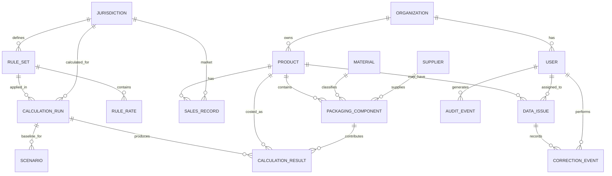
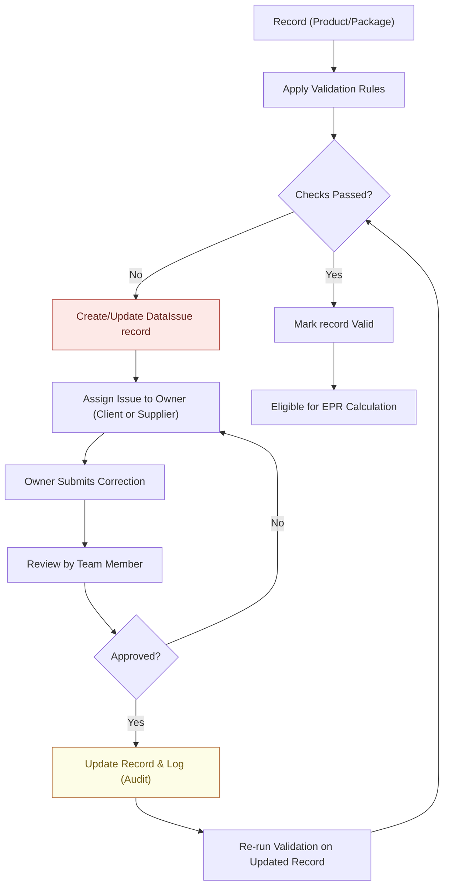
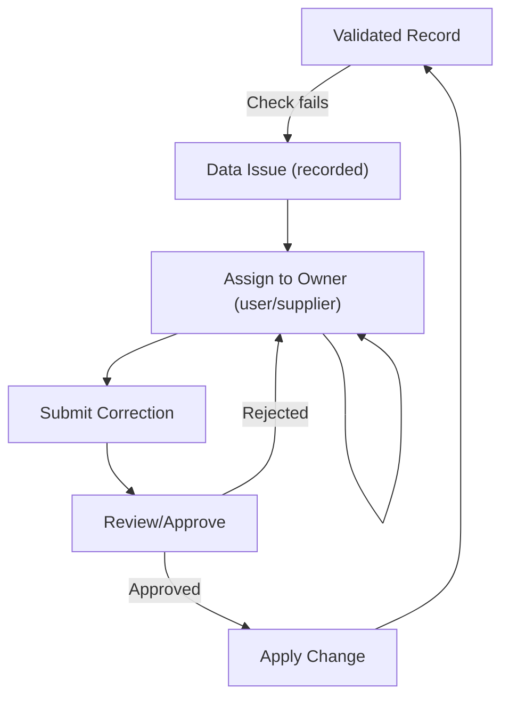

# Executive Summary 

This report outlines a complete, phase-wise plan to build the *Monkspaces Shared Data & Compliance* SaaS platform. The goal is to create a **centralized product and packaging data foundation** and then build modular compliance features (e.g. EPR fees, PPWR, DPP, costing) on top.  Key design principles include strong data governance, multi-tenant security, and versioned regulatory logic.  The proposed technology stack centers on **PostgreSQL** for data storage and **FastAPI/Angular** for a web front-end/API. Containerization (Docker/Kubernetes) and CI/CD pipelines ensure scalable, repeatable deployments. 

We recommend a controlled MVP approach: first deliver the data foundation, quality engine, and one jurisdiction’s EPR calculation and hotspots analytics.  Subsequent phases can add additional regulations and modules.  This approach de-risks the project and gives clear acceptance criteria at each phase. 

Key highlights of this plan:

- **Shared Data Foundation:** Ingest product/packaging data from multiple sources (ERP, PLM like Trace One, Snowflake, CSV/API). Normalize this into canonical tables (products, packaging components, materials, etc.) with strict audit and tenant isolation. Use a relational schema for fixed fields and *JSONB* for truly flexible attributes (with GIN indexes for search). Apply database **multi-tenancy** best-practice (schema-per-tenant or row-based with tenant_id) to ensure isolation and scalability.

- **Data Quality & Lineage:** Implement a rules engine that checks required fields, ranges, consistency, and business logic.  Flag missing or inconsistent data as *Data Issues* (severity levels) and suggest corrections.  Maintain full **data lineage and audit** (who changed what and when).  An issue correction workflow routes issues to owners (client or supplier), and records approved changes without silently altering source data.

- **EPR Calculation Engine:** Build a versioned rules engine where each jurisdiction’s fee schedule and logic is captured as a *Rule Set* (with effective dates).  Store each calculation’s inputs, applied rule version, and outputs for traceability.  The engine will output an explainable breakdown of fees by material, component and product.  Results are validated against reference cases to ensure accuracy (reconciliation tests).

- **Hotspot & Forecasting Module:** Using the calculated fees, the dashboard ranks cost “hotspots” by product, material, or category. It also offers a simple forecasting/scenario tool: project fees under current assumptions and allow “what-if” changes (e.g. reduce plastic weight, increase recycling) to show potential fee impacts. All scenarios are explainable and use the same data and rules for consistency.

- **Frontend & API:** The UI (Angular) will be organized by functional modules (data management, issue queue, calculations, dashboards). It will call a REST API (FastAPI/Python) for all backend logic. API contracts (request/response schemas) are defined in OpenAPI. This stack is modern and well-supported.

- **Security & Hosting:** Use OAuth2/OpenID Connect (e.g. Auth0 or Azure AD) for login and role-based access. Design multi-tenant isolation in the app layer (tenant IDs, row/scheme-based). Host on a cloud platform (AWS, Azure or GCP) with container orchestration (Docker + Kubernetes or managed services). Postgres will run either as a managed DB or in containers. Use S3 (or Azure Blob) for object storage (uploaded files, evidence, audits). CI/CD pipelines (e.g. GitHub Actions) will automate testing and deployment.

- **Phased Timeline (9–12 months for MVP):** A typical scenario with a 4–5 person team suggests ~6 months to an initial EPR MVP (usable data import, quality checks, one EPR jurisdiction).  We break this into *Discovery*, *Data Foundation*, *Data Quality*, *EPR Engine*, *Analytics*, and *Pilot* phases.  Each phase has clear gating criteria (e.g. data ready, reference fee agreement). The first 4 two-week sprints (Phase 0–2) focus on the data foundation and basic data-quality engine, then sprints 5–8 (Phase 3) complete the EPR calculation feature. 

- **Team & Sprints:** A cross-functional team (Solution Architect, 2 Backend Dev, 1 Frontend Dev, 1 QA/Data Engineer) can reach Phase 3 in ~8 weeks of sprints.  Required client inputs include sample packaging datasets, jurisdiction fee schedules/rules, and access to source systems for test data. 

Every design choice notes assumptions or unknowns (e.g. availability of Trace One APIs) to clarify what must be confirmed.  Mermaid diagrams are used below to illustrate the **data flow**, **system architecture**, **data-model**, and **correction workflow**. 

This plan balances completeness with agile delivery: it builds a solid foundation first, then adds compliance logic. By the end of Phase 3, the team will have a working end-to-end EPR calculation pipeline, meeting the critical acceptance tests for one jurisdiction.  

# 1. System Overview and Architecture 

## 1.1 Shared Data Foundation 

Monkspaces aims to ingest *all product and packaging data* from clients and suppliers into a **centralized repository**.  Typical sources include:
- **ERP systems (SAP, Oracle, Microsoft Dynamics, etc.)** – These hold product master, BOMs, and material specifications.  They may provide APIs or data extracts for integration.
- **PLM/Trace One/Devex** – Product Lifecycle Management systems commonly used in CPG. (Trace One advertises REST APIs for interoperability.) 
- **Data Warehouse (e.g. Snowflake)** – Clients often consolidate product/sales data here.
- **Supplier files or APIs** – Suppliers may supply CSV/Excel files (labels, spec sheets) or even have their own systems/APIs.
- **Manual entry** – For missing data, via admin forms in the UI.

All these inputs are **mapped and normalized** into a canonical schema.  The core entities include *Product*, *Packaging Component*, *Material*, *Supplier*, *Jurisdiction*, *Sales Volume*, *Rule Set*, etc.  (See **Section 2** for a sample ER diagram.)  We store metadata like source system and record IDs to maintain traceability.  The database design follows **normalization best practices** (3NF and above) to minimize redundancy. For flexibility, truly variable attributes (e.g. a packaging-specific field only present for some items) can be stored in a `JSONB` column with appropriate GIN indexes. In general, key fields used for filtering or joining should be relational columns to ensure performance.

**Multi-Tenancy:** The platform is SaaS with multiple client-organizations.  We will use a *schema-per-tenant* (or *tenant_id column with row-level security*) approach in Postgres, as recommended for SaaS apps.  Each tenant’s data is isolated in the DB, though the same codebase and instance serve all. This “soft isolation” allows scaling and sharing while keeping data private.

## 1.2 Data Ingestion & Connectors 

Monkspaces will support several connector strategies, layered for flexibility:

- **Batch CSV/API Loads:** In Phase 1, the simplest approach is to accept uploaded files or scheduled exports. For example, clients supply periodic Excel/CSV exports of product and packaging attributes. The system’s **Import service** reads these files, parses columns and maps them to our schema fields.  
- **Scheduled Sync:** For more automation, a scheduled job can call source system APIs (e.g. SAP OData, Oracle REST) or query Snowflake on a timer (daily/weekly) to pull updates. This requires configuring credentials and mappings.  
- **Webhooks/Event-Driven:** If a source system supports it, we can subscribe to events (e.g. via a message queue) so that new/changed records trigger an immediate sync. This yields near-real-time updates.  
- **Change Data Capture (CDC):** A more advanced option for relational sources. CDC tools (Debezium, AWS DMS, etc.) monitor DB transaction logs to capture inserts/updates/deletes. We could use CDC to stream changes from ERP or Snowflake into Monkspaces. CDC “enables incremental loading or real-time streaming of data changes into the target”, avoiding large batch loads. We treat CDC as a future extension if near-live sync becomes critical.  

Every ingestion path writes to a staging area in our system and then to the canonical tables. Mappings translate source fields to target columns (e.g. `sap:MaterialNumber → packaging_component.material_id`).  **Normalization rules** (lookups, units, naming standards) are applied here. For example, we may normalize units (grams vs kg) or material codes to standard categories. All transformations and source IDs are stored so any record’s lineage can be traced back.

### Example: Data Flow Diagram

```mermaid
flowchart TB
    subgraph Sources
        S1["ERP System"] 
        S2["PLM (Trace One/Devex)"]
        S3["Snowflake DB"]
        S4["Supplier Files/APIs"]
        S5["Manual Input (UI)"]
    end
    subgraph Monkspaces
        A[Ingestion Service<br/>(CSV/API/CDC)] 
        B[Mapping & Normalization] 
        C[(Raw Data Staging)]
        D[Centralized Data Store<br/>(Postgres)] 
        E[Data Quality Engine]
        F[Issue Queue & Workflow] 
        G[EPR Engine & Rules]
        H[Analytics & Dashboard]
    end
    S1 --> A
    S2 --> A
    S3 --> A
    S4 --> A
    S5 --> B
    A --> B
    B --> C --> D
    D --> E --> F
    F --> D
    D --> G --> H
    click G href "#epr-calculation" "See EPR Calculation details"
    note right of A "Batch or CDC pulls data"
    note right of B "Apply unit conversions, lookups"
    note right of E "Validate and flag data quality issues"
    note right of F "Correct in workflow then re-run checks"
    note right of G "Versioned fee calculation logic"
```

**Sources Integration Status (assumptions):** At startup, we do not assume live integrations. Connections to Trace One or Snowflake will be verified (auth, APIs, schema) in Discovery. If unavailable, we’ll rely on manual/CSV imports as fallback. All such integrations will be marked as *To Be Verified* until confirmed with the client.

## 1.3 System Architecture 

Monkspaces will be a cloud-hosted web application (SaaS). The high-level architecture (logical components) is:

```mermaid
flowchart TB
    subgraph FRONTEND
        UI["Angular Web App"]
        AUTH["OIDC Auth (e.g. OAuth2)"]
    end
    subgraph API
        API["Backend API (FastAPI)"] 
        ING["Import Module"]
        DQ["Data Quality Engine"]
        WF["Workflow/Corrections Module"]
        RULES["Rule Management (EPR Rates)"]
        EPR["EPR Calculation Engine"]
        ANA["Analytics Module (Hotspots/Scenarios)"]
        AUD["Audit/Logging Service"]
    end
    subgraph STORAGE
        DB[(Postgres Database)]
        FILES[(Object Storage for docs/files)]
        HISTORY[(Audit/Calc History DB)]
    end
    UI <--> AUTH
    UI <--> API
    API --> ING
    API --> DQ
    API --> WF
    API --> EPR
    API --> ANA
    EPR <--> RULES
    API --> AUD
    ING --> DB
    DQ --> DB
    WF --> DB
    RULES --> DB
    EPR --> DB
    ANA --> DB
    AUD --> HISTORY
    API --> HISTORY
```

- **Angular Frontend:** A Single-Page App with secure login, dashboards, and forms. It calls backend REST endpoints for data. We will follow Angular best practices with modular components (see Section 4).
- **Backend (FastAPI/Python):** Provides JSON APIs. FastAPI is chosen for its performance and built-in OpenAPI support. Endpoints include data retrieval, import initiation, issue management, calculation triggers, etc. Alternative stacks (Node.js/Express, .NET) are possible, but Python’s rich ecosystem (Pandas, math libraries) is a strong fit for analytics.
- **Import Module:** Handles file upload or source-API pulls. Parses and maps incoming data to the DB.
- **Data Quality Engine:** Contains validation rules. It reads each record, checks constraints, and writes `DataIssue` records for any violations.
- **Workflow Module:** Manages issue assignment, correction submission, review/approval. It updates the central store and audit logs upon corrections.
- **Rule Management:** Admin interface and DB tables to store jurisdiction-specific EPR rule sets and effective dates. Operators here can upload new rate tables or modulation logic. Each *RuleSet* is immutable once approved.
- **EPR Calculation Engine:** Uses validated data and a selected rule version to compute fees. Implemented as a stateless service called by the API. It writes results and history.
- **Analytics Module:** Generates hotspot rankings and baseline/“what-if” forecasts from the calculation outputs.
- **Database (Postgres):** Stores all relational data (see Section 2). JSONB columns are used sparingly for flexible fields. We will enable **GIL-less threading** in Postgres to support parallel queries if needed.
- **Object Storage:** For uploaded spreadsheets, images, evidence documents. S3 or compatible store.
- **Audit/History Storage:** Could be in the same Postgres (audit tables) or a separate datastore. We log every change, calculation run, and user action for traceability.
- **Authentication:** Integrate with an OAuth2/OIDC provider (client’s Identity provider or Auth0). We enforce tenant-based access control on APIs. 

This architecture is **modular** but initially can be a “modular monolith” or few microservices. Depending on team size, the components may all live in a single codebase with clear module boundaries. Later scaling could separate them (e.g. make the EPR engine a separate microservice if performance demands). 

# 2. Canonical Data Model 

The core relational entities for packaging and compliance are as follows (simplified):



**Key entities and fields:**

- **Organization (Tenant):** id, name, (other subscription info). Each client is a tenant (multi-tenant).  
- **User:** id, organization_id, role (admin, reviewer, etc.), contact info.  
- **Product:** id, organization_id, SKU, name, category, etc.  (plus `source_system` and `source_record_id` for lineage).  
- **PackagingComponent:** id, product_id (FK), supplier_id (FK), material_id (FK), level (primary, secondary, etc.), weight (value, unit), dimensions, other attributes (shape, fill %).  A JSONB column can hold additional attributes not modeled relationally (with appropriate caution).  
- **Material:** id, code (e.g. “PET”, “Glass”), description, *category* (for EPR fees) if needed.  Materials map to fee categories (plastic, paper, metal, etc.).  
- **Supplier:** id, name, (address, etc.). Used if we route issues to a supplier.  
- **SalesRecord:** id, product_id, jurisdiction_id, quantity (or weight sold), fiscal_year.  
- **Jurisdiction:** id, code (e.g. “DE” or “FR”), scheme name, etc.  
- **RuleSet:** id, jurisdiction_id, version, effective_from, effective_to (nullable), status (draft/approved).  Contains many RuleRate entries.  
- **RuleRate:** id, rule_set_id, material_category, rate (per unit or per weight), other adjustment fields. This models the published fee schedule.  
- **DataIssue:** id, product_id (or component_id), issue_type (MissingField, InconsistentWeight, etc.), severity (Error/Warning), status (Open/Resolved), created_at.  
- **CorrectionEvent:** id, issue_id, actor_id (user), action (Submitted/Approved/Rejected), old_value, new_value, timestamp.  Records every fix attempt.  
- **CalculationRun:** id, rule_set_id, jurisdiction_id, status, calculated_at, parameters (e.g. included years, override flags).  
- **CalculationResult:** id, run_id, product_id (or packaging_component_id), fee_amount, currency.  
- **Scenario:** id, run_id, name, assumptions (JSON of changed inputs), created_by, created_at.  Represents a what-if case branching from a baseline run.  
- **AuditEvent:** id, actor_id, entity_type, entity_id, action (UPDATE/INSERT/etc.), timestamp, detail (JSON of changes).

For **tenant isolation**, either each table has an `organization_id` FK (with row-level security enforcing it), or we employ separate schemas per organization. The IBM reference recommends PostgreSQL schemas for soft isolation. We may choose one approach (likely `organization_id` columns) and enforce RLS policies.

**Storage Patterns (JSONB vs Relational):** Most of the above are relational. Use JSONB sparingly for truly dynamic data. For example, an audit log might store `before_state JSONB, after_state JSONB` for any entity. Also a generic `parameters JSONB` column in CalculationRun can store variable inputs. JSONB gains benefit from GIN indexing if we ever search inside them, but by default they should be for blob-like storage (or easily defined partial indexes).  In contrast, fields we’ll filter on (like material category, weight, status flags) should be columns.

Tables will have standard `created_at`, `updated_at`, and soft-delete flags if needed.  Every versioned object (RuleSet, CalculationRun) is append-only: do not overwrite historical rows.  This supports auditability and reproducibility. 

**Example schema snippet (Postgres DDL):**

```sql
CREATE TABLE organizations (
  id UUID PRIMARY KEY, name TEXT NOT NULL
);
CREATE TABLE users (
  id UUID PRIMARY KEY, organization_id UUID REFERENCES organizations, 
  name TEXT, role TEXT, email TEXT
);
CREATE TABLE products (
  id UUID PRIMARY KEY, organization_id UUID REFERENCES organizations,
  sku TEXT, name TEXT, category TEXT,
  source_system TEXT, source_id TEXT
);
CREATE TABLE materials (
  id UUID PRIMARY KEY, code TEXT UNIQUE, description TEXT, category TEXT
);
CREATE TABLE suppliers (
  id UUID PRIMARY KEY, name TEXT
);
CREATE TABLE packaging_components (
  id UUID PRIMARY KEY, product_id UUID REFERENCES products, 
  supplier_id UUID REFERENCES suppliers, material_id UUID REFERENCES materials,
  level TEXT, weight_value DECIMAL, weight_unit TEXT,
  data_quality_status TEXT, last_sync TIMESTAMPTZ,
  attributes JSONB  -- optional flexible attributes
);
-- etc.
```

(Full DDL is in docs; above is illustrative.)

# 3. Data Quality and Correction Workflow 

Maintaining high data quality is crucial. The system will automatically **validate** incoming data and surface any issues. Each record runs through a set of validation checks, for example:
- **Required fields:** E.g. weight, material, target market must be present. Missing values become a high-severity issue.
- **Type/unit checks:** Weight must be positive, units valid (g, kg, etc.). Date fields in range, numeric fields not NaN.
- **Cross-field consistency:** Sum of component weights should equal total packaging weight within tolerance; component-level recyclable % should not exceed 100%.
- **Lookup validity:** A material code not mapping to our known categories triggers a classification issue.
- **Business rules:** e.g. If a component is marked as “recyclable”, then the material must support recycling (else warn).
- **Regulatory requirements:** If a field is needed for compliance (like *EPR compliance scheme*), absence is flagged.

Each check yields either “pass”, “warning”, or “error”. Errors block completion; warnings alert review. 

**Rule Engine Design:** We will implement these checks in a rules framework. Each rule has metadata (ID, description, severity). The rules engine iterates records (either on import or as a batch job) and creates a `DataIssue` entry for any violation. The issues include context (which field, expected vs found) and pointers to the record. A severity value lets us sort critical vs minor.  Where possible, the engine can **auto-suggest** fixes (e.g. “Weight unit missing: default to grams?”). Ultimately, however, human review is needed for acceptance.



1. **Issue Creation:** If any validation fails, a `DataIssue` is generated (or updated if already exists). It captures the issue type, affected entity, severity, and references.  Issues are grouped in a queue.
2. **Assignment:** Each issue is automatically assigned an owner (perhaps the internal data steward, or the original data supplier if known). Owners get notified (via UI or email) of the tasks to fix.
3. **Correction Submission:** The owner corrects the data. This may involve editing fields in the UI, uploading new values, or attaching documents as evidence.
4. **Review & Approval:** A data steward reviews submitted corrections. On *approval*, the system writes the new values into the central store (and optionally back to the source if write-back is enabled). Every change creates a `CorrectionEvent` audit record. If *rejected*, the issue stays open for further input.
5. **Re-validation:** After correction, the record is re-run through validation. If now passing, the issue is closed and the record becomes “clean” (status updated). If still failing, a new issue arises. 

**Audit Trail:** Importantly, all original values and corrections are preserved. We never silently overwrite source data without an audit trail. Every insert/update is logged (with user and timestamp) into an **audit log**. This ensures full data lineage: for any final record used in compliance calculation, we can trace back to its original inputs and correction history.

**Write-Back Constraint:** In general, Monkspaces is the “master of record” for compliance data. We can **suggest** updates to source systems (e.g. via API write-back to ERP/PLM), but that requires heavy coordination and permissions. Until verified, corrections stay within Monkspaces, and source owners must manually sync if needed. (This assumption should be reviewed early.)

# 4. Compliance Modules Design

## 4.1 EPR Calculation Engine 

**Design Goals:** The EPR engine must compute fees accurately and traceably.  Key requirements:

- **Versioned Logic:** Each jurisdiction’s fee rules (rates by material, thresholds, fixed fees, eco-modulation factors) are captured as a *RuleSet* with a version and effective date range. When regulations change, we create a new RuleSet version; old calculations remain tied to their original version.
- **Input Data:** The engine consumes validated packaging quantities, material categories, and sales volumes for the selected reporting period and market(s). Each product’s fee is typically (weight × rate) plus fixed fees, summed across components.
- **Explainability:** The output should include a breakdown (per material and component) and identification of which rates/adjustments were applied. This allows users to audit why a fee was charged.
- **Persistence:** Every calculation run (triggered by a user or schedule) is stored. We record its inputs (IDs, quantities, rule version) and outputs (fee amounts). This allows re-running the same calculation (to compare with a new rule version) and auditing.
- **Reconciliation Testing:** For each jurisdiction, we should have sample test cases (from the client or regulators). E.g. “Product X: 2 kg plastic, 1 kg glass → fee should be €Y”. Automated tests compare engine outputs to these expected results. Discrepancies indicate rule or data issues. 
- **Error Handling:** If data is missing (e.g. no weight or no category), the engine should skip or flag that product and not silently assume zero.

**Calculation Flow:** 

```mermaid
flowchart TB
    R["Approved Rule Set"] --> P["Prepare Fee Schedules"]
    A["Validated Product Data"] --> P
    P --> C["Compute Fees per Component"]
    C --> S["Sum to Product Fee"]
    S --> O["Store Results (component/product level)"]
    O --> H["Hotspot Ranking"]
    O --> F["Forecast & Scenario Module"]
    O --> D["Export and Reports"]
    click C href="#explainability" "Explainability Detail"
```

- *Prepare Fee Schedules:* Load the rate tables from the selected RuleSet (e.g. € per kg of each material category).
- *Compute Fees:* For each packaging component or material in a product, compute `(quantity × rate) + adjustments`. If schemes have fixed fees (e.g. per product), add those.
- *Sum Fees:* Aggregate component fees up to product, and totals for the brand or company.
- *Results:* Write `CalculationResult` records. Tag them with references to RuleSet version and reporting year.
- *Hotspots & Forecasts:* Trigger analytics (see below).
- *Reconcile:* Compare total fees against any pre-calculated expectation.

**Explainability:** Since compliance is legal, we must show how each number was derived. For a given product, the UI might show:
```
Product A Fees:
 - PET plastic (Total 1.5 kg @ 0.10 €/kg): 0.15 €
 - Glass (0.5 kg @ 0.20 €/kg): 0.10 €
 - 1 fixed fee for primary packaging: 0.05 €
Total EPR Fee: 0.30 €
(RuleSet v3, effective 2026)
```
This level of detail is built into the calculation logic and stored in `CalculationResult` or a detail table.

**Testing:** We will write unit and integration tests. For each jurisdiction, client provides 3–5 test products with expected fees. The Phase 3 acceptance tests include “run these cases and match expected fees.” After implementation, the team can demonstrate reconciliation in the UI or logs.

## 4.2 Hotspot Analysis & Forecasting

Beyond raw fees, business users need insights:

- **Hotspot Ranking:** Identify the top cost drivers. For example, aggregate fees by material (e.g. “PVC components account for 40% of total fee”), or by product line. A bar chart or table can rank products by total fee. This helps target data improvement or material substitution efforts.

- **Baseline Forecast:** Given current product portfolio and sales volumes, project the total fees for upcoming period. This uses the actual volumes and assumes rules unchanged. It may include multi-year trends if we have historical data.

- **What-if Scenarios:** Allow the user to tweak assumptions and see impact. For example: “If I reduce LDPE by 10% across all SKUs” or “If market share shifts”. The UI could let users modify one input (units sold, weight, material mix) and recalc fees. The system would run a *Scenario* based on the baseline run. Results include absolute change and percent difference. Importantly, do *not* present these as guaranteed savings, but as illustrative outcomes.

All analytics use the same rule engine under the hood: the scenario run simply injects different input data before fee calculation.

# 5. API & Frontend (Angular) 

The platform’s client-facing interface is an Angular web app. It will have modules like:
- **Dashboard (Home):** High-level KPIs, recent data imports, error counts, quick links to action items.
- **Product Data Management:** Searchable lists of products/packaging components. Detail pages show all attributes and lineage. Users can upload new data files or manually edit.
- **Data Issues Queue:** List of open data-quality issues, filterable by severity, assignee, status. Detailed issue page allows submitting corrections.
- **Correction Form:** A guided form where assigned users enter corrected values (with optional file attachments).  
- **EPR Calculation:** Interface to select a jurisdiction and period, run calculation, and view results. Users see a table of products and fees plus the explainability breakdown.
- **Hotspots:** Charts/tables of top 10 products or materials by fee.  
- **Scenario Builder:** A form to define a scenario (e.g. change weight of a component), then compare a brief summary of baseline vs scenario.
- **Administration:** (Phase 1+) Manage jurisdictions and rule sets (upload new rates, set effective dates), user/tenant settings, and source-system connectors.

**API Contract:** We will use REST with JSON. Endpoints will follow best practices (e.g. `GET /api/products`, `POST /api/calculation/run`, etc.). OpenAPI schema will be documented. Example:
```yaml
POST /api/calculations:
  description: Calculate fees for selected jurisdiction and period.
  requestBody:
    content:
      application/json:
        schema:
          type: object
          required: [jurisdictionId, reportingYear]
          properties:
            jurisdictionId:
              type: string
            reportingYear:
              type: integer
            includeForecast:
              type: boolean
  responses:
    '200':
      description: Returns a runId and summary metrics.
      content:
        application/json:
          schema:
            type: object
            properties:
              runId: {type: string}
              totalFees: {type: number}
```
We will generate client TypeScript models from these specs, ensuring compile-time checks on API usage.

**Angular Details:** Angular’s module/component structure supports our domain-driven design. We will build feature modules (e.g. `ProductsModule`, `EprModule`, `AdminModule`). Services in Angular call the backend APIs. 

- Use **RxJS** for handling asynchronous data flows.
- A component library (Angular Material or similar) can speed up building forms and tables.
- Implement unit tests with Jasmine/Karma and end-to-end tests with Protractor or Cypress.

No heavy UI design is needed for the initial PoV; focus is on functionality. A simple, clean layout is sufficient, with richer UI (charts, summaries) added in Phase 4.

# 6. Security, Multi-Tenancy, and Hosting 

**Authentication & Authorization:** We will integrate with an OAuth2/OpenID Connect provider (e.g. Auth0, Okta, or the client’s existing identity system).  Users must log in to access the app.  The JWT token will include tenant ID and roles.  Backend enforces that each API request only sees data for that tenant (using RLS or app logic).

User roles (Admin, Analyst, Data Steward, Supplier) will control access. For instance, only Admins upload rule sets; Suppliers see only their assigned issues.

**Tenant Isolation:** As per IBM guidance, we ensure “each tenant’s data is isolated and invisible to other tenants”. This is achieved in the DB (schema or RLS) and in the app logic. No data from one client should leak to another.

**Hosting:** Cloud hosting is assumed (AWS/Azure/GCP) for SaaS. Use managed services where possible:
- **Compute:** Kubernetes (EKS/AKS/GKE) cluster running our containers, or use serverless containers (AWS Fargate).
- **Database:** Amazon RDS PostgreSQL (or Azure Database for PostgreSQL) for durability. Enable automated backups and Multi-AZ for high availability.
- **Object Storage:** S3 or Azure Blob for uploaded documents.
- **CI/CD:** We recommend GitHub Actions or Azure DevOps for pipelines. Every commit triggers builds, unit tests, and (optionally) deployments to a dev/staging cluster. Docker images are built for backend and frontend and pushed to a registry.

All traffic should be over HTTPS. Secrets (DB passwords, API keys) are stored in the cloud’s secrets manager or Kubernetes secrets.

**Compliance and Hardening:** By Phase 5 (Pilot), we will incorporate security testing (e.g. OWASP scans for the web app) and ensure compliance measures (like encryption at rest, audit logs). 

# 7. Implementation Roadmap 

We propose a **phased delivery** with gating criteria. Each phase has clear outputs:

| Phase         | Key Output                            | Exit/Gate Criteria                                               |
|---------------|---------------------------------------|-----------------------------------------------------------------|
| **0. Discovery & Design** (2–3 wks)  | Requirements, use-case, sample data, architecture docs | Client confirms target market(s), data sources, and provides sample data and expected rule logic.                                 |
| **1. Data Foundation** (4–6 wks)     | Working import pipelines, core schema, product/packaging data loaded | Representative records successfully import; DB schema reviewed; data lineage proven.                                     |
| **2. Data Quality Engine** (4–6 wks)  | Validation rules, issue queue, correction workflow UI | Test issue gets flagged, assigned, corrected, approved, and revalidated.                                |
| **3. EPR Calculation (1st Jurisdiction)** (4–6 wks) | One jurisdiction end-to-end; fee calculations stored | Sample calculations reconcile with reference; results reproducible with same inputs.                        |
| **4. Analytics** (3–5 wks)           | Hotspot dashboard, baseline & simple scenarios | Aggregated fees match calculation totals; scenario comparisons make sense.                                  |
| **5. Pilot Hardening** (3–4 wks)     | Testing, security, documentation, user feedback incorporated | Regression tests passing; security review done; pilot readiness validated.                              |
| **6. Expansion** (Ongoing)           | Additional jurisdictions/modules integrated | Each new addition has its own gating (rules confirmed, tested).                                          |

The estimated total to reach the **usable MVP** (end of Phase 4) is ~4–6 months. This can be compressed or extended based on team size and evolving scope.

### Gating Criteria
- *Phase 0 ➔ 1:* Confirm access to at least one real data source (even as file) and that we have jurisdiction fee tables in hand.  
- *Phase 1 ➔ 2:* Loaded data covers required fields; minimal product set imported.  
- *Phase 2 ➔ 3:* Correction loop working on test issues, no high-severity data gaps remain for demo products.  
- *Phase 3 ➔ 4:* Calculated fees for demo products match client’s known values; rule logic validated by subject matter expert.  
- *Phase 5:* Security sign-off and satisfactory performance.  

# 8. Team Roles, Sprints & Timeline 

A small, cross-functional team can execute this plan.  For planning, we assume **two-week sprints** and a core team of: 
- **Solution Architect/Tech Lead (1 FTE):** Oversees design, mentors devs, integrates modules. 
- **Backend Developers (2 FTE):** Build API, data import, business logic, calculation engine. 
- **Frontend Developer (1 FTE):** Build Angular UI, connect with APIs. 
- **QA/Test Engineer (0.5–1 FTE):** Write and run tests, validate outputs. 
- **Data/DevOps Engineer (0.5 FTE):** Setup DB, CI/CD, deployments, maybe initial data mapping. 
- **Product Owner/BA (0.5 FTE):** Gathers requirements, liaises with client, writes acceptance tests. 
- **Regulatory SME (0.2 FTE):** Validates compliance logic, rules.

Below is a **summary of the first 4 sprints** (up to completing Phase 3) with roles and tasks. We target ~8–10 total sprint-weeks to finish the end-to-end EPR PoV.

| **Sprint** | **Key Goals/Tasks**                                                         | **Team**         | **Deliverables**                          |
|-----------|------------------------------------------------------------------------------|------------------|-------------------------------------------|
| 1         | – Define data model in detail; set up Postgres (schema/RLS). <br>– Build basic import service (file upload parser or stub API connector). <br>– Populate DB with sample product/packaging records. <br>– Angular: initial login and product list page. | Arch (design), 2×BE (DB, import), FE (UI skeleton), 0.5 QA, 0.5 BA | Data schema, import pipeline prototype, seeded DB, simple UI listing products. |
| 2         | – Extend imports to more fields/sources, implement normalization (units, categories). <br>– Implement first validation rules (required fields, type checks). <br>– Build issue queue API & simple UI table. <br>– Angular: view/edit product details. | 2×BE, FE, QA, Arch, 0.5 BA, 0.5 SME | More complete data loaded; errors generated for test cases; UI to view issues. |
| 3         | – Complete validation rules (range checks, cross-field). <br>– Correction workflow: endpoints for submit correction, approve. <br>– Audit logging of changes. <br>– Angular: issue detail and correction form. <br>– Begin EPR engine: define RuleSet schema, import first fee schedule. | 2×BE (including BE devoted to rules), FE, QA, Arch, 0.2 SME | Data issues can be corrected end-to-end; first RuleSet loaded (no calc yet). |
| 4         | – Finalize EPR calculation logic for one jurisdiction. <br>– API to trigger calculation and retrieve results. <br>– Store CalculationRun and results. <br>– Angular: calculation page showing breakdown, total fee. <br>– QA: reconciliation tests (sample products vs expected fees). | 2×BE (calc engine), FE, QA, Arch, SME (rule validation) | Full EPR pipeline: select market/period, calculate, and display fees; test cases passing. |

**Team Size:** 4–5 people actively in Sprints 1–4. Roles can overlap (one BE could handle import and EPR logic sequentially). The architect/lead participates heavily early on. As we approach Sprints 3–4, involvement of the Regulatory SME and QA peaks for testing. DevOps tasks (container setup) are done in Sprint 1–2.

**Subsequent Sprints (5–8):** would focus on hotspot dashboards, scenario UI, admin screens, polishing security, and more test cases. Additional resources (e.g. extra developer) can be onboarded if deadlines are tight.

### Client Inputs Needed

To proceed efficiently, the team requires from the client (KHC or similar):
- **Sample Data Sets:** Anonymized product and packaging data (CSV/DB extract) covering a representative range. This includes product SKUs, component weights, materials, and sales volumes by market/year. (As soon as Sprint 0/1.)  
- **Jurisdiction Fee Schedules:** Official tables and rules for at least one EPR program (e.g. EU country or India), including rates per material, fixed fees, and any eco-modulation rules. Ideally in spreadsheet form. (Sprint 0/1.)  
- **Access to Source Systems:** Credentials or data dumps from ERP/PLM/Snowflake for testing integration. (Sprint 1.)  
- **Business Rules Clarifications:** Documentation on business logic (e.g. how to handle multi-layer packaging, exemptions).  
- **Approval for Test Cases:** Known products with expected fee outputs to use as unit tests (Sprint 3–4).  

Without these, assumptions must be made and the proof-of-value limited to sample data.

# 9. Tech Stack & Alternatives 

**Database:** PostgreSQL (v15+ recommended) is chosen for its robustness, JSONB support and RLS features. Alternatives: MySQL (no JSONB) or commercial (Oracle) but open source is simpler for a new SaaS. For analytics-heavy scenarios, a data warehouse could be added later, but not in MVP. 

**Backend API:** Python with **FastAPI**. FastAPI is “modern, fast” and has excellent async support. It generates OpenAPI docs automatically. Alternatives: Node.js/Express, .NET Core, or Java/Spring. We choose FastAPI for rapid dev and Python’s libraries (pandas, numpy, datetime).  Post-deployment, it can scale behind Uvicorn/Gunicorn workers.

**Frontend:** Angular (latest, e.g. Angular 17). Angular is well-suited for large enterprise SPAs, with a rich CLI, TypeScript safety, and a component/module architecture. Alternatives include React or Vue. Angular was chosen given existing team experience (assumed) and its structured approach to code organization.

**Object Storage:** AWS S3 (or Azure Blob). Alternatives: MinIO self-hosted, Google Cloud Storage. S3 is a de facto standard for files/evidence.

**Auth:** OAuth2/OIDC. Possible providers: Auth0, Okta, Azure AD B2C. If the client uses Azure, Azure AD is natural. This ensures we don’t handle passwords or tokens ourselves.

**CI/CD:** GitHub Actions (built-in with repo) or Azure DevOps pipelines. Jenkins or GitLab CI are alternatives. We will containerize the app (Docker) and push images to a registry (Docker Hub or ECR/ACR) in CI.

**Infrastructure:** Kubernetes is recommended for production for its autoscaling and management. Cloud-managed Kubernetes (EKS/AKS/GKE) would be ideal. For a simpler start, AWS Elastic Beanstalk or Azure App Service for Containers could also host the app. However, containers always help replicate environments.

# 10. Infrastructure & Deployment 

- **Containers:** We will Dockerize the backend and frontend. According to Docker docs, “a container is a standard unit of software that packages up code and all its dependencies”.  This means “it will always run the same, regardless of environment”, eliminating “works on my machine” problems.  
- **Orchestration:** Kubernetes or ECS to run the containers. This enables rolling updates and scaling. We set resource requests/limits per service.  
- **Database:** A managed Postgres (Amazon RDS or Aurora) ensures backups and HA. Alternatively, run Postgres in a StatefulSet on K8s with PVs.  
- **Object Store:** An S3 bucket (with appropriate IAM roles) for any file uploads or static assets.  
- **CI/CD Pipelines:** On each commit to main branch, run linter, unit tests, build Docker images, push to registry, and (optionally) deploy to a test environment.  
- **Monitoring:** Use Prometheus/Grafana or a cloud monitoring tool to watch metrics (response time, error rates, DB usage). Use ELK or a logging service to collect logs.  
- **Encryption:** TLS for all traffic, encryption at rest for DB and storage as per compliance.  

# 11. Risks & Assumptions 

- **Assumption:** Trace One/Devex and Snowflake connections are possible. *Verification:* Early in Phase 0, confirm API availability or export methods.  
- **Assumption:** We know which jurisdiction to start with. If not, we need to decide quickly or risk building to the wrong rules.  
- **Assumption:** Client can provide sample data and rulebooks. No data means no demo.  
- **Risk:** If data is very inconsistent, the data-quality phase may expand. We mitigate by MVP focusing on a subset of products.  
- **Risk:** Integration delays (e.g. waiting for IT access). Use mock data in the meantime.

All assumptions will be listed in the “Open Issues” section of project docs, and addressed in gating decisions.

# 12. Acceptance Criteria for Phase 3 (EPR Engine)

By the end of Sprint 4/Phase 3, the EPR module must be demonstrably correct and integrated. Key acceptance criteria include:

1. **Calculation Accuracy:** For a given set of input products, the calculated fees must match expected values. We will use at least 3 reference cases (provided by the client’s compliance team or regulator) to test this.  
2. **Traceability:** The UI must display the rule version and breakdown for each product. A reviewer should be able to trace exactly how each fee line was computed.  
3. **Persistence:** Calculation results and history are stored. Running the same jurisdiction/period again should yield identical totals (idempotence).  
4. **Error Handling:** If some products lack data (e.g. missing market), they should not be included silently; the system should flag which products were excluded.  
5. **Performance:** The initial calculation run should complete within a reasonable time (e.g. under 1 minute for a few hundred SKUs). Bottlenecks should be identified.

Test cases will include edge conditions like zero volumes (should yield zero fee) and boundary volumes.

# 13. Appendix: Sample API Contract and Diagrams

**Sample API Request (FastAPI/Pydantic style):**

```python
from pydantic import BaseModel
from typing import List, Optional

class CalcRequest(BaseModel):
    jurisdiction_id: str
    reporting_year: int
    product_ids: Optional[List[str]] = None

class CalcResponse(BaseModel):
    run_id: str
    total_fee: float
    currency: str

@router.post("/api/calculations", response_model=CalcResponse)
def run_calculation(request: CalcRequest):
    # (Backend logic here)
```

**Mermaid: Data Quality & Correction Flow (detail):**



*(All diagrams and contracts to be maintained in the project documentation. Existing Mermaid code blocks can be kept in `docs/` for versioning.)*

# Citations

- IBM on multi-tenancy and SaaS architecture  
- Docker documentation on containers  
- PostgreSQL documentation on JSONB indexing  
- IBM on database normalization benefits  
- Confluent on Change Data Capture (CDC)  
- *Trace One PLM* marketing (integration emphasis) (used as anecdotal evidence)  

All technical choices (Angular, FastAPI) reference community best practices and official docs. Internal assumptions and client-specific data needs are explicitly noted as requiring validation.  

